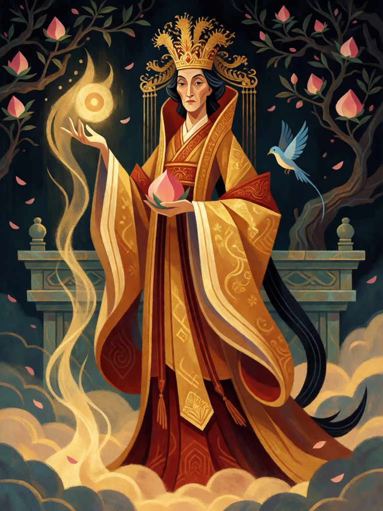

# Xiwangmu, Rainha Mãe do Oeste

[← Taoismo](../taoismo.md) · [Wiki KodeX](../README.md) · [◀ Guan Yu, Imperador Guan](tao_guan_yu.md) · [Imperador de Jade ▶](tao_imperador_de_jade.md)

| Carta | Arte |
|---|---|
|  |  |

| | |
|---|---|
| **Tradição** | Taoismo |
| **Tipo** | Entidade |
| **Custo de Fé** | 6 |
| **ATK / DEF** | 4 / 5 |
| **Palavras-chave** | — |
| **Lendária** | sim |
| **Cópias no deck** | 1 |
| **Id** | `tao_xiwangmu` |

## Texto da carta

> Despertar: reviva uma Entidade do seu cemitério para o campo.

**EN — Xiwangmu, Queen Mother of the West:** *Awaken: Revive an Entity from your graveyard to the field.*

## Contexto mitológico

Xiwangmu (西王母, Rainha Mãe do Oeste) começa como monstro e termina como soberana. No *Shanhaijing* ("Clássico das Montanhas Oeste") ela "tem forma humana, cauda de leopardo e dentes de tigre, assobia bem, cabelo desgrenhado com um adorno *sheng*; preside às pragas do céu e às cinco punições". Vive na Montanha de Jade, no Kunlun, servida por três pássaros azuis. O *Mu Tianzi zhuan* já a mostra brindando com o rei Mu de Zhou, e nos Han ela se torna a rainha de todos os imortais, objeto de um culto de massas no ano 3 a.C. (registrado no *Hanshu*).

Seu pomar guarda os pêssegos da imortalidade, que amadurecem a cada três mil anos; no *Han Wudi neizhuan* ela desce ao palácio do imperador Wu na sétima noite do sétimo mês trazendo sete pêssegos: come três e dá quatro ao imperador, que guarda os caroços para plantar — "não dão fruto nesta terra", ela ri, "amadurecem a cada três mil anos". É dela o elixir que Houyi recebe e Chang'e rouba. Na *Jornada ao Oeste* (cap. 5) é a anfitriã do Banquete dos Pêssegos que Sun Wukong saqueia. Na religião popular é consorte do Imperador de Jade e padroeira das mulheres e da longevidade.

Lendária de custo 6: a fonte da imortalidade, não sua beneficiária. Ela não precisa voltar — ela é quem dá o pêssego: ao chegar, devolve um morto ao campo, inteiro — o corpo e o que ele carrega de permanente.

## Papel no jogo

Virada de meio-fim de jogo: no turno 6 traz de volta ao campo o melhor corpo do cemitério (Guan Yu com Guarda, Lü Dongbin com a aura, Nezha com Ímpeto) e fica como 4/5 que ainda troca com quase tudo. O revivido volta **sem Despertar** (reviver para o campo não o dispara, regras §8) — prefira corpos cujo valor é contínuo. Com Zhongli Quan, a Pílula de Ouro e o Pássaro Vermelho forma o motor de reciclagem do deck; morta, pode ser trazida de volta por eles como 4/5. Vulnerável a devolver à mão (perde o Despertar) e a Zhang-Guolaos inimigos em geral.

## Atributos visuais

coroa de fênix dourada · túnica dourada de mangas longas que cobre o peito · pêssego rosa na palma · pássaro azul ao lado · rainha madura

Balanço (conta de custo)

Orçamento P = 2·C+1 = 13 pts; Lendária até +2 = 15. Gasto: ATK 4 + Vida 5 + Despertar "revive para o campo" (3 + custo do alvo ÷ 2; alvo típico 2–3 → 4–4,5; pior caso Guan Yu/Erlang, custo 5 → 5,5) = 13,5–14,5. Dentro, mesmo no pior caso. _(Revisão: a versão com Renascer somava 15,5 no caso típico e 16,5 revivendo um custo 5 — acima do teto de Lendária; o Renascer saiu, o que também tira uma das sete fontes de recursão do deck.)_

Ficha completa: `cartas/taoismo/13_xiwangmu.md` · cartas base da versão Alpha
