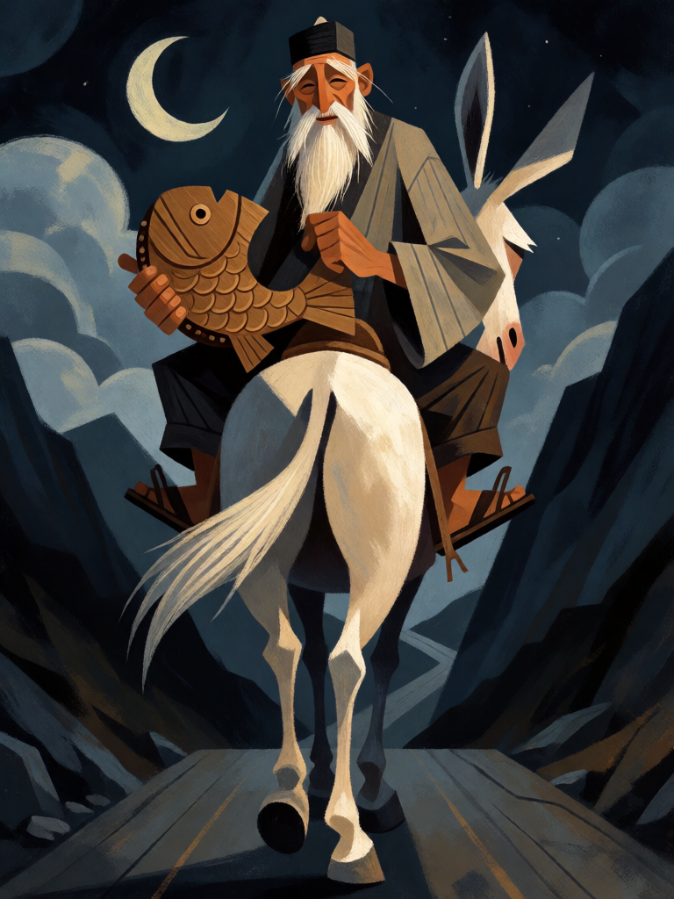

# Zhang Guolao

[← Taoismo](../taoismo.md) · [Wiki KodeX](../README.md) · [◀ Lü Dongbin](tao_lu_dongbin.md) · [Cao Guojiu ▶](tao_cao_guojiu.md)

| Carta | Arte |
|---|---|
|  |  |

| | |
|---|---|
| **Tradição** | Taoismo |
| **Tipo** | Entidade |
| **Custo de Fé** | 3 |
| **ATK / DEF** | 2 / 3 |
| **Palavras-chave** | — |
| **Lendária** | não |
| **Cópias no deck** | 1 |
| **Id** | `tao_zhang_guolao` |

## Texto da carta

> Despertar: devolva uma Entidade inimiga à mão do dono.

**EN — Zhang Guolao:** *Awaken: Return an enemy Entity to its owner's hand.*

## Contexto mitológico

Zhang Guolao (張果老, "o Velho Zhang Guo") é o único dos Oito Imortais com registro em história oficial: o *Jiu Tang shu* e o *Xin Tang shu* trazem a biografia de Zhang Guo, eremita dos montes Zhongtiao (Shanxi) que dizia ter sido ministro do imperador mítico Yao e que o imperador Xuanzong (r. 712–756) mandou buscar à corte, onde ele fez prodígios e recusou a mão de uma princesa.

Seu emblema é a mula branca que monta ao contrário, de costas para a estrada, percorrendo milhares de li por dia. Ao descansar, dobra a mula como se fosse papel e a guarda numa caixinha; quando precisa viajar, borrifa água e a mula se desdobra inteira. Carrega o *yugu*, tambor de bambu em forma de peixe, com que acompanha canções taoistas. Fontes: *Minghuang zalu* (Tang), *Taiping Guangji*, *Dongyou Ji*. É padroeiro dos anciãos e invocado por casais que querem filhos.

A dobra da mula virou mecânica: ao chegar, Zhang Guolao "dobra" uma Entidade inimiga e a devolve à mão — ela existe, mas terá de ser paga de novo.

## Papel no jogo

Resposta de tempo: devolve à mão a ameaça que o oponente acabou de pagar caro, ou a que recebeu buffs (eles somem) e Relíquia (que vai ao cemitério com a saída da portadora). Num deck sem remoção dura, é a melhor ferramenta contra Entidades de custo 5+. Pior uso: devolver um corpo barato com Despertar forte, que volta e repete o efeito.

## Atributos visuais

montado de costas na mula branca · olhando para a cauda da mula · tambor de bambu em forma de peixe · barba branca longa · gorro preto

Balanço (conta de custo)

Orçamento P = 2·C+1 = 7 pts. Gasto: ATK 2 + Vida 3 + Despertar "devolver Entidade inimiga à mão" (2) = 7. Dentro.

Ficha completa: `cartas/taoismo/07_zhang_guolao.md` · cartas base da versão Alpha
