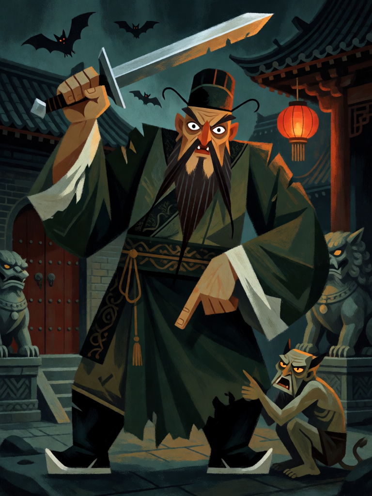

# Zhong Kui

[← Taoismo](../taoismo.md) · [Wiki KodeX](../README.md) · [◀ Nezha](tao_nezha.md) · [Erlang Shen ▶](tao_erlang_shen.md)

| Carta | Arte |
|---|---|
|  |  |

| | |
|---|---|
| **Tradição** | Taoismo |
| **Tipo** | Entidade |
| **Custo de Fé** | 4 |
| **ATK / DEF** | 3 / 4 |
| **Palavras-chave** | — |
| **Lendária** | não |
| **Cópias no deck** | 1 |
| **Id** | `tao_zhong_kui` |

## Texto da carta

> Despertar: silencie uma Entidade inimiga (ela perde palavras-chave e habilidades).

**EN — Zhong Kui:** *Awaken: Silence an enemy Entity (it loses keywords and abilities).*

## Contexto mitológico

Zhong Kui (鍾馗) é o caçador de fantasmas da China: homem corpulento de barba eriçada, olhos esbugalhados, túnica de letrado e botas, de espada em punho, cercado de pequenos demônios que ele escraviza ou devora. A lenda, registrada por Shen Kuo no *Mengxi bitan* (séc. XI), conta que Zhong Kui foi um candidato dos exames imperiais nos Tang, brilhante mas feio demais; recusado (ou roubado do primeiro lugar), suicidou-se nos degraus do palácio. O imperador Xuanzong, doente, sonhou com um demônio pequeno roubando-lhe a flauta de jade e a bolsa de perfume; então um gigante de boné rasgado agarrou o ladrão, arrancou-lhe os olhos e o comeu, apresentando-se como Zhong Kui. O imperador acordou curado e mandou Wu Daozi pintar o retrato.

Desde então sua imagem é colada nas portas no Ano-Novo e no quinto dia do quinto mês (Duanwu) para afastar espíritos; o *Zhong Kui quanzhuan* (Ming) estende as aventuras, incluindo o casamento que ele arranja para a irmã. Na hierarquia taoista ele recebe do Imperador de Jade o cargo de expulsar demônios em todo o império.

Virou a carta de silêncio: o exorcismo não destrói, apenas tira do inimigo tudo o que ele tinha de sobrenatural.

## Papel no jogo

Remoção "mole" que o deck precisa: cala Guarda, Renascer, auras e Despertares já em campo sem destruir (coerente com "dano direto quase zero"). Corpo 3/4 sólido para a curva de 4. Melhor alvo: Entidade inimiga com Relíquia ou com Renascer. Não resolve estatísticas puras — contra um 5/5 sem texto, é só um 3/4.

## Atributos visuais

olhos esbugalhados · barba preta eriçada · gorro de letrado rasgado · espada erguida · pequeno demônio encolhido

Balanço (conta de custo)

Orçamento P = 2·C+1 = 9 pts. Gasto: ATK 3 + Vida 4 + Despertar "silenciar Entidade inimiga" (2) = 9. Dentro.

Ficha completa: `cartas/taoismo/10_zhong_kui.md` · cartas base da versão Alpha
