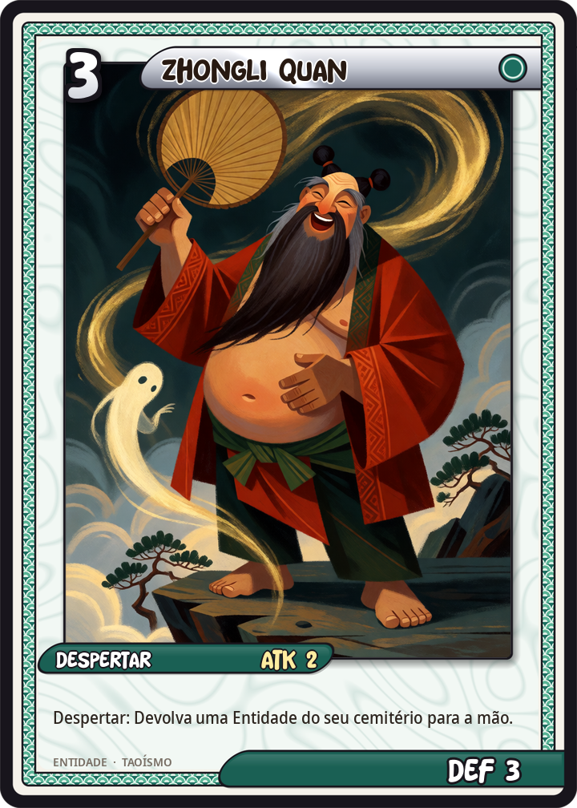
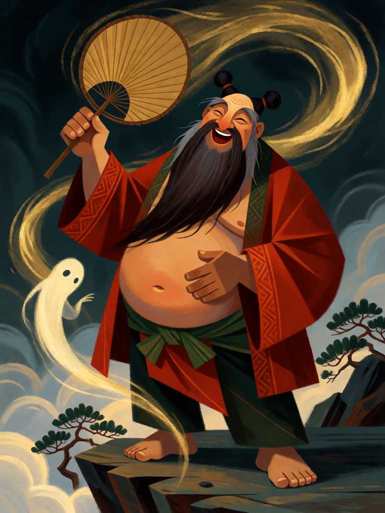

# Zhongli Quan

[← Taoismo](../taoismo.md) · [Wiki KodeX](../README.md) · [◀ Li Tieguai](tao_li_tieguai.md) · [Lü Dongbin ▶](tao_lu_dongbin.md)

| Carta | Arte |
|---|---|
|  |  |

| | |
|---|---|
| **Tradição** | Taoismo |
| **Tipo** | Entidade |
| **Custo de Fé** | 3 |
| **ATK / DEF** | 2 / 3 |
| **Palavras-chave** | — |
| **Lendária** | não |
| **Cópias no deck** | 1 |
| **Id** | `tao_zhongli_quan` |

## Texto da carta

> Despertar: devolva uma Entidade do seu cemitério para a sua mão.

**EN — Zhongli Quan:** *Awaken: Return an Entity from your graveyard to your hand.*

## Contexto mitológico

Zhongli Quan (鍾離權), também Han Zhongli, é o decano dos Oito Imortais: um homem gordo de barriga à mostra, barba longa e cabelo preso em dois coques, abanando-se com um leque de folha de palmeira ou de plumas. A tradição o faz general da dinastia Han que, derrotado em campanha contra os tibetanos, fugiu para as montanhas e ali encontrou um velho mestre que lhe ensinou a alquimia. Seu leque ressuscita os mortos e transforma pedra em ouro e prata — ouro que ele distribuía aos pobres em anos de fome.

Zhongli Quan importa sobretudo como mestre de Lü Dongbin: a linhagem "Zhong-Lü" de alquimia interna (*Zhong-Lü chuandao ji*, Song) atribui a ele e ao discípulo o diálogo fundador do *neidan*, e a escola Quanzhen o conta entre seus Cinco Patriarcas do Norte. A hagiografia dos Oito está no *Dongyou Ji* (Ming); seu nome aparece já no *Xuanhe shupu* (Song) como calígrafo imortal.

A carta usa o leque: ao entrar, Zhongli traz de volta um morto — para a mão, não para o campo, porque o leque desperta mas não planta.

## Papel no jogo

O reciclador do deck: devolve à mão o Imortal que morreu cedo (Lan Caihe, Han Xiangzi) para repetir o Despertar, ou recupera Nezha depois do segundo óbito. Jogado no turno 3 depois de uma troca ruim, estabiliza; no fim do jogo devolve Xiwangmu. Quase inútil com o cemitério vazio — então é um 2/3 por 3, dentro da curva.

## Atributos visuais

homem gordo de barriga à mostra · leque de folha de palmeira · dois coques no cabelo · barba longa · túnica vermelha aberta

Balanço (conta de custo)

Orçamento P = 2·C+1 = 7 pts. Gasto: ATK 2 + Vida 3 + Despertar "revive para a mão" (2) = 7. Dentro.

Ficha completa: `cartas/taoismo/05_zhongli_quan.md` · cartas base da versão Alpha
