# Cristianismo

[← Wiki KodeX](README.md)

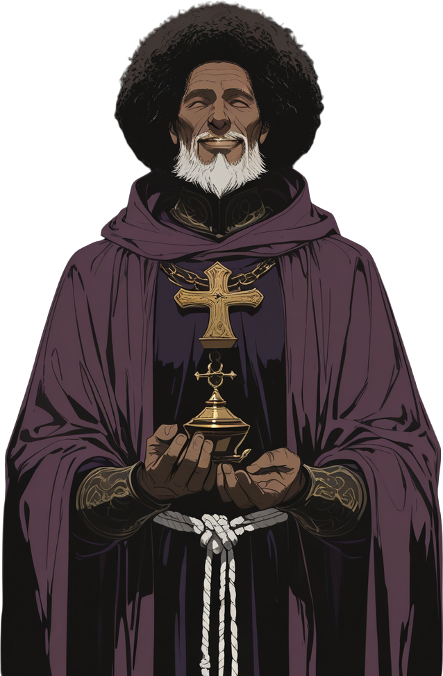

**Campeão no torneio:** Frei Bento Amaral — *O Exorcista de Ouro Preto*

## Identidade do deck

**Ressurreição e julgamento.** O deck cristão não corre: ele *persiste*. Suas Entidades voltam — por **Renascer** (Jonas, Lázaro, Elias; o Véu de Verônica o concede a quem não tem), por Ritos que revivem direto para o campo (Talita Cumi) ou pelo Selo que reabre a tumba quando um aliado cai no turno do oponente (Tumba Vazia). Quem volta ao campo volta como corpo: reviver não dispara Despertar (regras §8) — o julgamento de Miguel e o fogo de Elias acontecem uma vez por invocação da mão. Anjos com **Guarda** (Anjo da Guarda, Serafim, Miguel, Arca) seguram a linha enquanto a cura (Rafael, Santo Graal, Multiplicação dos Pães, Cova dos Leões, Leviatã) devolve Vida às Entidades e à Cornucópia. É um deck de atrito: você perde pouco de cada vez e recupera o que perdeu.

A remoção é **"justa"**: condicional ou tardia. Judite só decapita quem custa ≤ 3; Sangue nos Umbrais só fere quem atacou; Miguel é Lendária de custo 7; o Juízo Final destrói *todas* as Entidades — inclusive as suas, que voltam por Renascer e, uma delas, pelo próprio Rito (Tumba Vazia **não** dispara no seu turno). O Exorcismo não mata: devolve à mão. As pragas do Egito (Gafanhotos, Granizo e Fogo), Sansão e Elias são o dano em área, e o dano direto à Cornucópia aparece numa única carta (1 ponto). Busca: só Gabriel. O deck sofre contra agressão rápida antes do turno 3 e contra `silence` nas suas Entidades com Renascer; brilha em partidas longas e contra decks que apostam tudo em uma Entidade grande.

**28 cartas distintas · 32 no deck**

## Entidades

<a href="cartas/cri_anjo_da_guarda.md">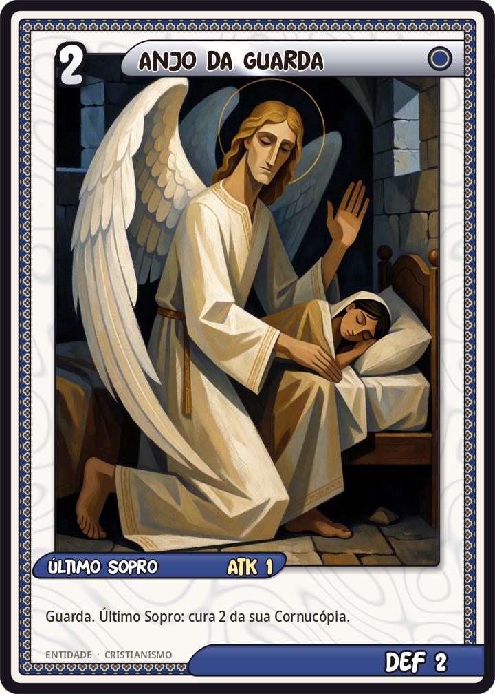</a> <a href="cartas/cri_jonas.md">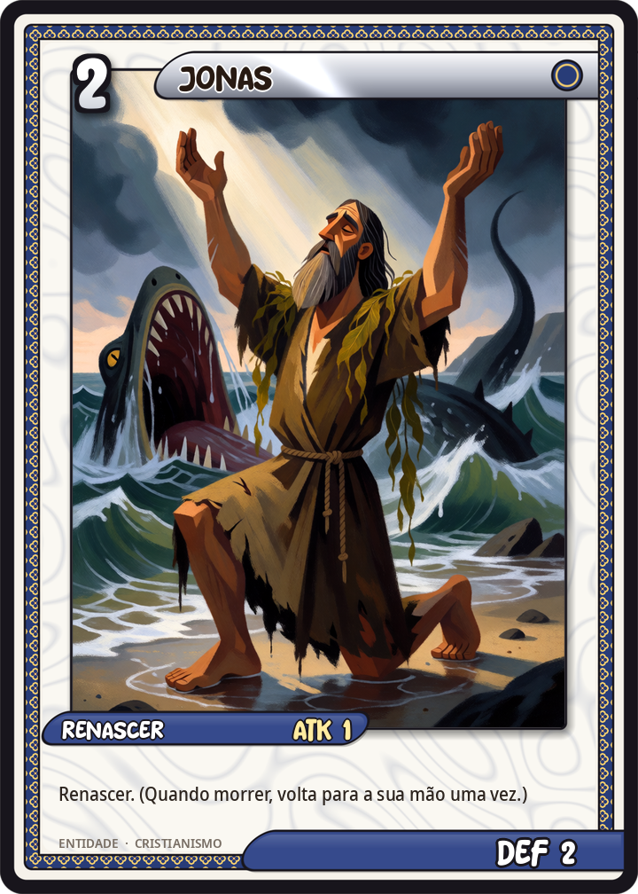</a>  <a href="cartas/cri_lazaro_de_betania.md">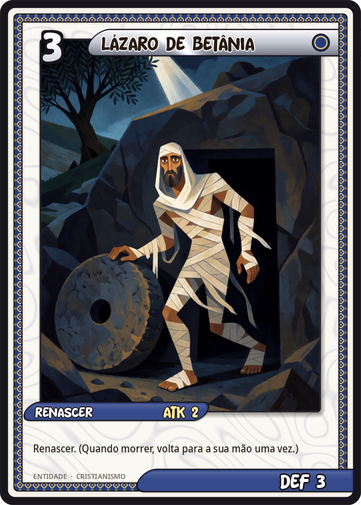</a>

 <a href="cartas/cri_gabriel.md">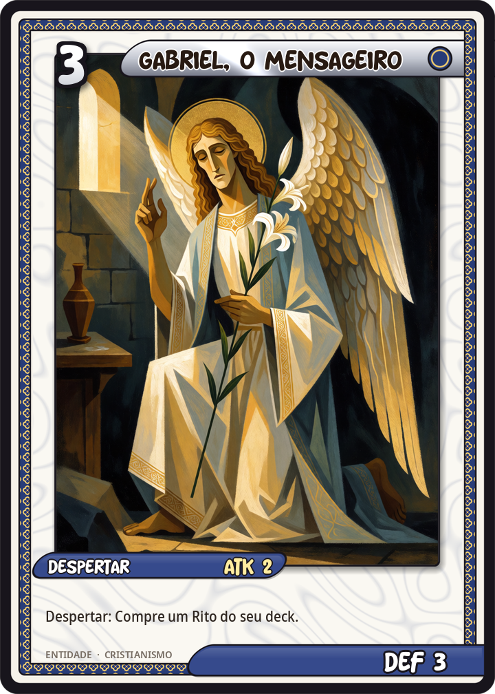</a> <a href="cartas/cri_rafael.md">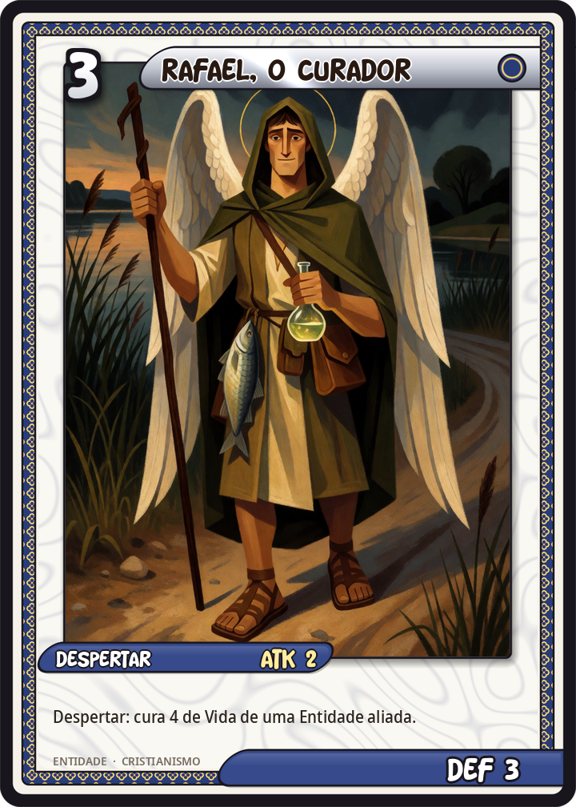</a> <a href="cartas/cri_sansao.md">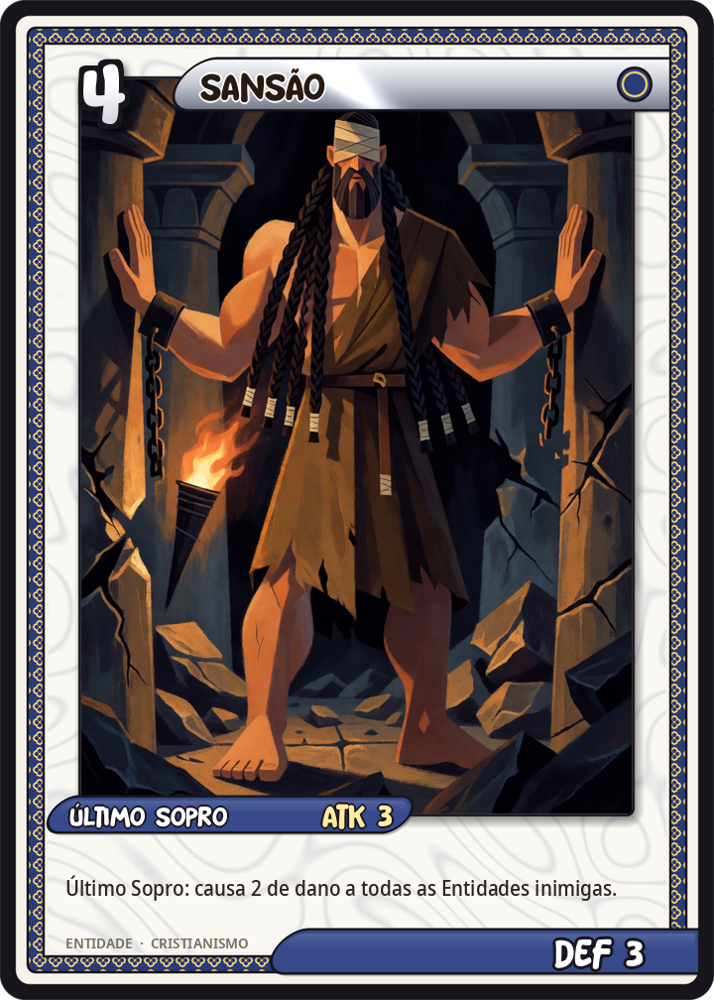</a>

<a href="cartas/cri_serafim.md">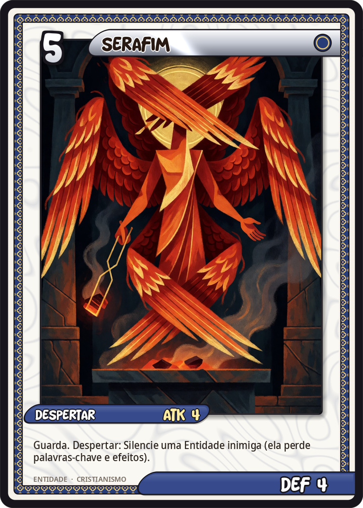</a>  <a href="cartas/cri_elias.md">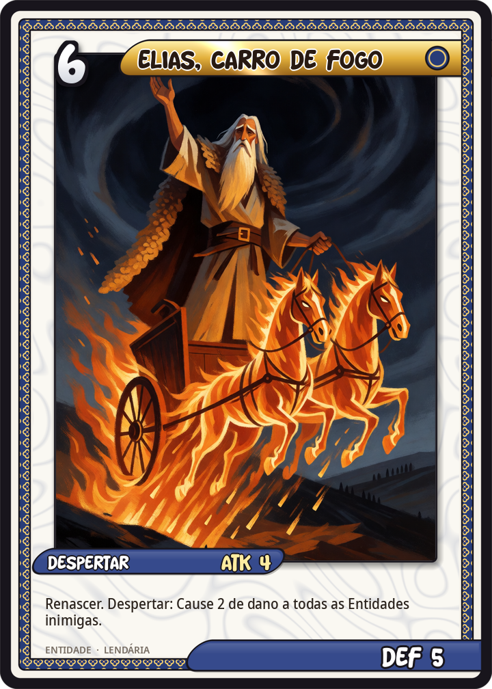</a> <a href="cartas/cri_sao_miguel_arcanjo.md">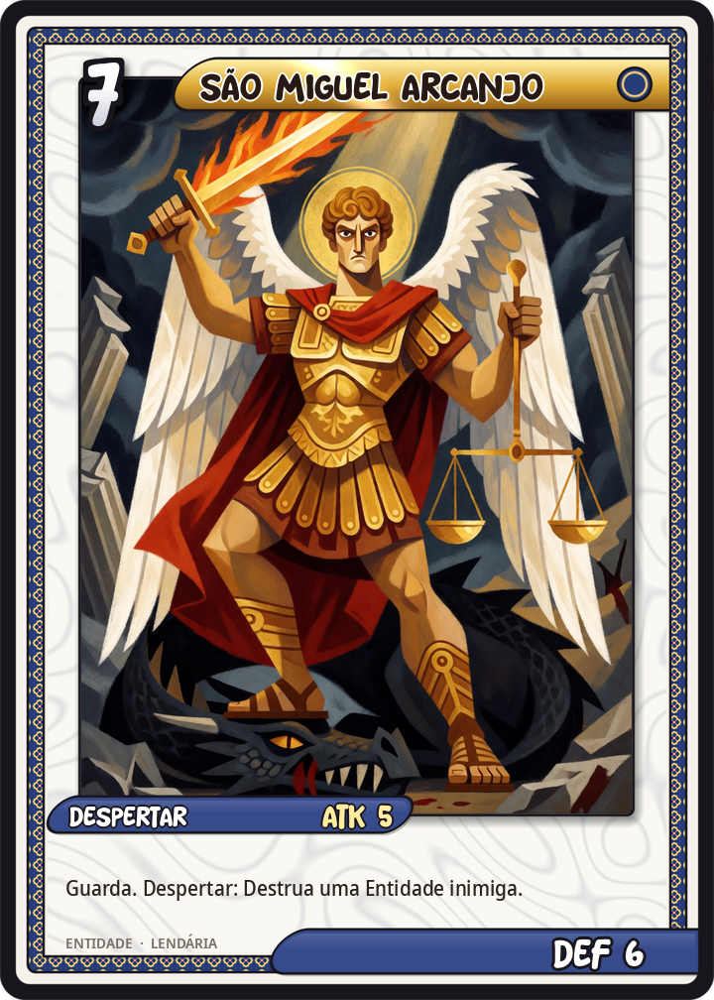</a>

| Carta | Atributos | Texto |
|---|---|---|
| [Anjo da Guarda](cartas/cri_anjo_da_guarda.md) ×2 | Entidade · custo 2 · ATK 1 / DEF 2 | Guarda. Último Sopro: cura 2 da sua Cornucópia. |
| [Jonas](cartas/cri_jonas.md) | Entidade · custo 2 · ATK 1 / DEF 2 | Renascer. (Quando morrer, volta para a sua mão uma vez.) |
| [Davi, o Pastor](cartas/cri_davi_o_pastor.md) | Entidade · custo 2 · ATK 1 / DEF 2 | Ao atacar, causa 2 de dano a uma Entidade inimiga à sua escolha. |
| [Lázaro de Betânia](cartas/cri_lazaro_de_betania.md) ×2 | Entidade · custo 3 · ATK 2 / DEF 3 | Renascer. (Quando morrer, volta para a sua mão uma vez.) |
| [Judite](cartas/cri_judite.md) | Entidade · custo 3 · ATK 2 / DEF 1 | Despertar: destrói uma Entidade inimiga de custo 3 ou menos. |
| [Gabriel, o Mensageiro](cartas/cri_gabriel.md) | Entidade · custo 3 · ATK 2 / DEF 3 | Despertar: busque um Rito do seu deck para a mão. |
| [Rafael, o Curador](cartas/cri_rafael.md) | Entidade · custo 3 · ATK 2 / DEF 3 | Despertar: cura 4 de Vida de uma Entidade aliada. |
| [Sansão](cartas/cri_sansao.md) | Entidade · custo 4 · ATK 3 / DEF 3 | Último Sopro: causa 2 de dano a todas as Entidades inimigas. |
| [Serafim](cartas/cri_serafim.md) | Entidade · custo 5 · ATK 4 / DEF 4 | Guarda. Despertar: silencia uma Entidade inimiga (perde palavras-chave e efeitos). |
| [Leviatã](cartas/cri_leviata.md) | Entidade · custo 6 · ATK 6 / DEF 7 | Sacrifício 1. Último Sopro: cura 4 da sua Cornucópia. |
| [Elias, Carro de Fogo](cartas/cri_elias.md) | Entidade · custo 6 · ATK 4 / DEF 5 · **Lendária** | Lendária. Renascer. Despertar: fogo do céu — 2 de dano a todas as Entidades inimigas. |
| [São Miguel Arcanjo](cartas/cri_sao_miguel_arcanjo.md) | Entidade · custo 7 · ATK 5 / DEF 6 · **Lendária** | Lendária. Guarda. Despertar: destrói uma Entidade inimiga. |

## Selos

<a href="cartas/cri_cova_dos_leoes.md">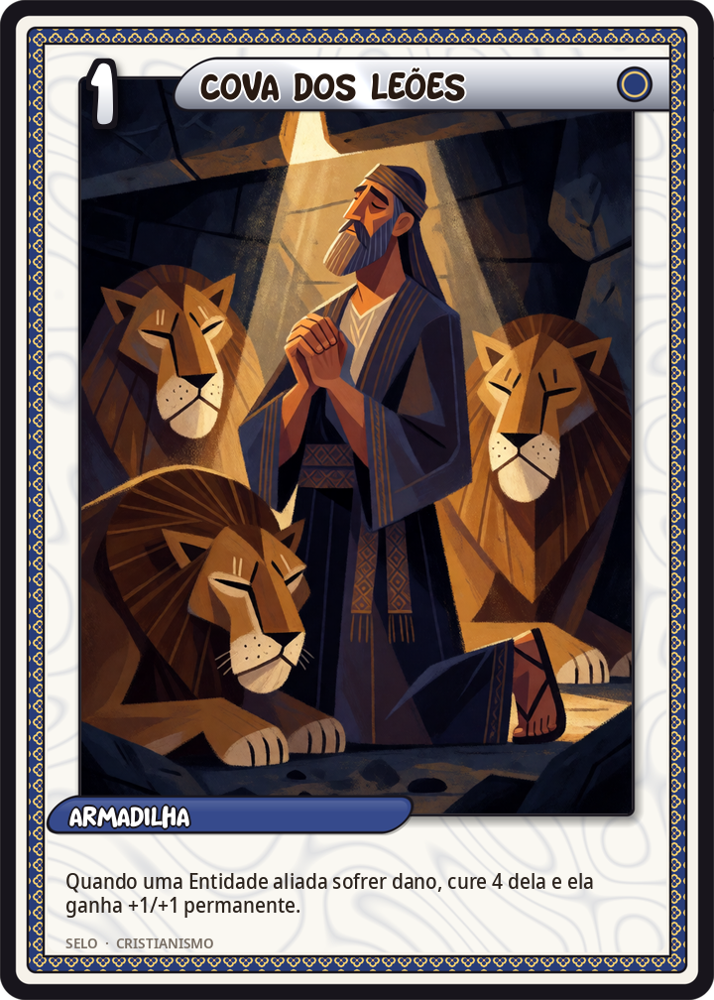</a> <a href="cartas/cri_tumba_vazia.md">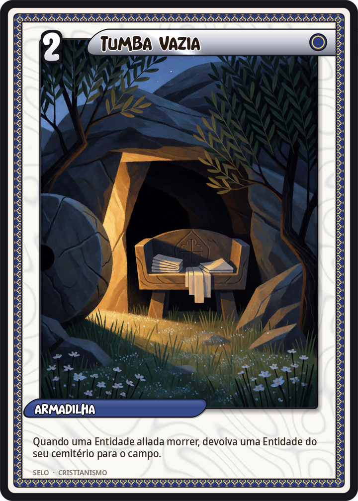</a> <a href="cartas/cri_portao_do_eden.md">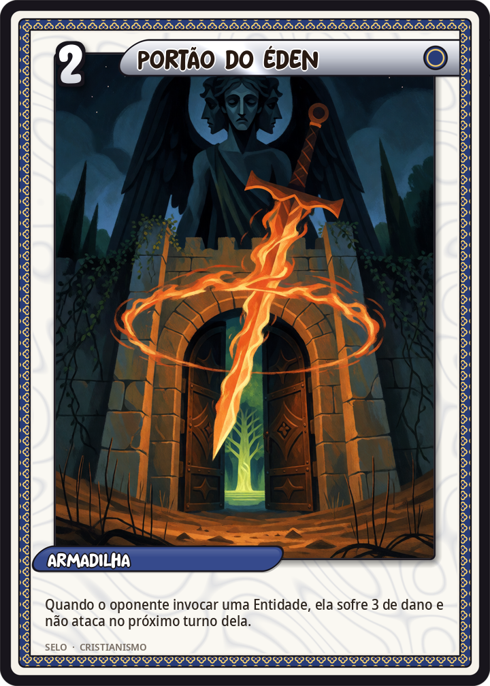</a> <a href="cartas/cri_mudez_de_zacarias.md">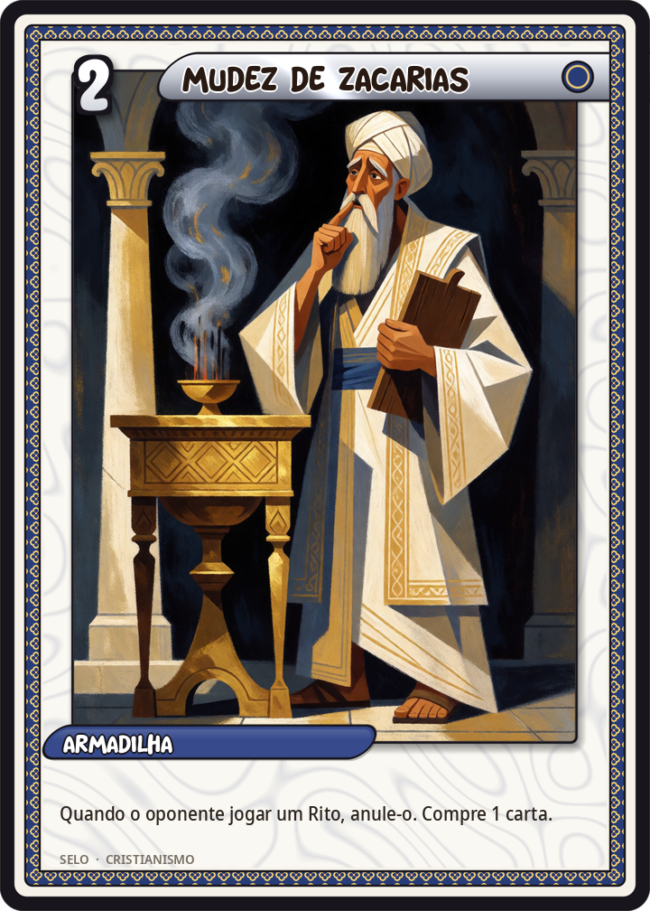</a>

| Carta | Atributos | Texto |
|---|---|---|
| [Cova dos Leões](cartas/cri_cova_dos_leoes.md) | Selo · custo 1 | Quando uma Entidade aliada sofrer dano, cure 4 dela e ela ganha +1/+1 permanente. |
| [Tumba Vazia](cartas/cri_tumba_vazia.md) ×2 | Selo · custo 2 | Quando uma Entidade aliada morrer, reviva uma Entidade do seu cemitério para o campo. |
| [Portão do Éden](cartas/cri_portao_do_eden.md) | Selo · custo 2 | Quando o oponente invocar uma Entidade, ela sofre 3 de dano e não ataca no próximo turno dela. |
| [Mudez de Zacarias](cartas/cri_mudez_de_zacarias.md) | Selo · custo 2 | Quando o oponente jogar um Rito, anule-o. Compre 1 carta. |
| [Sangue nos Umbrais](cartas/cri_sangue_nos_umbrais.md) | Selo · custo 3 | Quando uma Entidade inimiga atacar, destrua-a. Cure 4 da sua Cornucópia. |

## Ritos

<a href="cartas/cri_multiplicacao_dos_paes.md">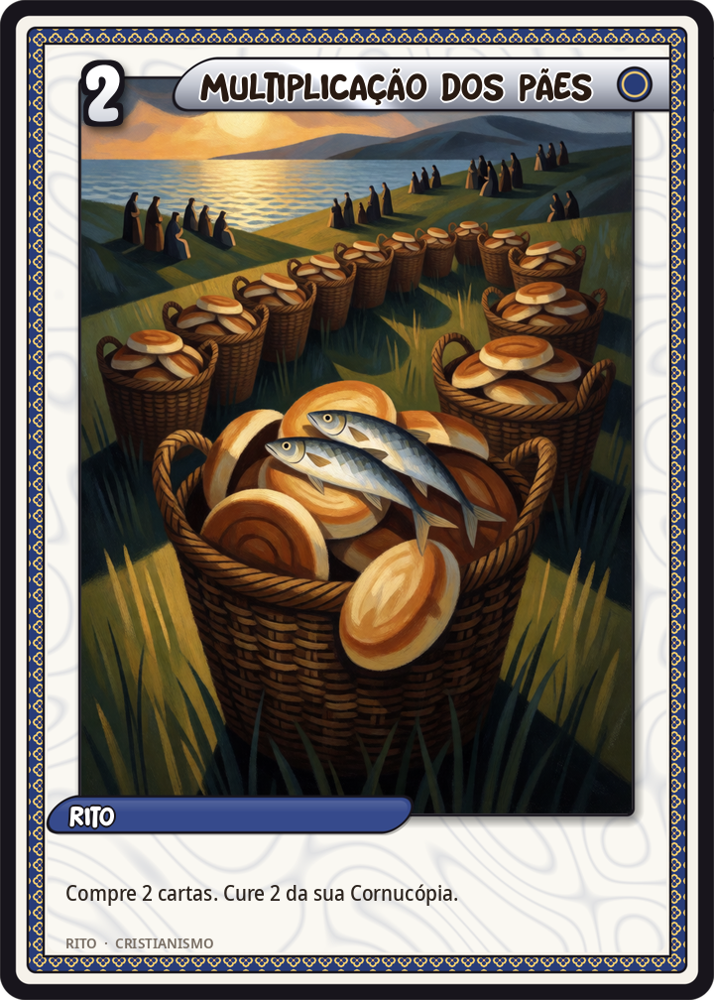</a>  <a href="cartas/cri_praga_dos_gafanhotos.md">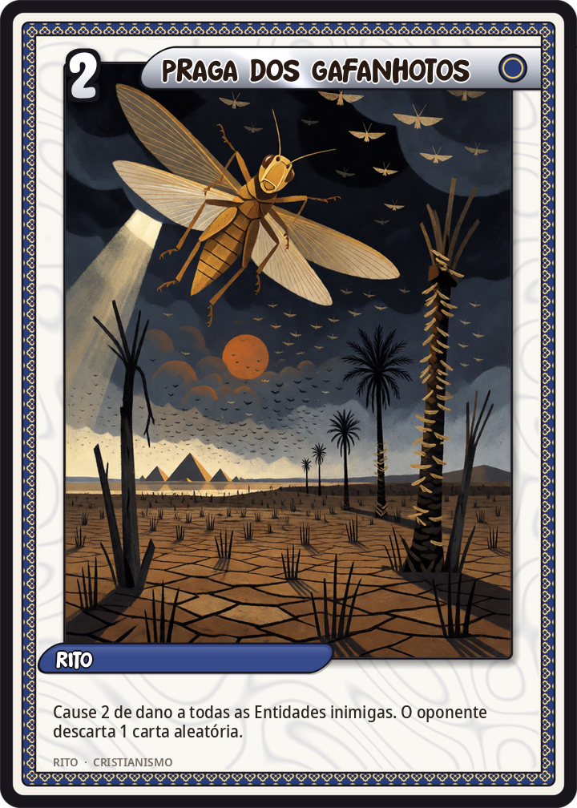</a> <a href="cartas/cri_talita_cumi.md">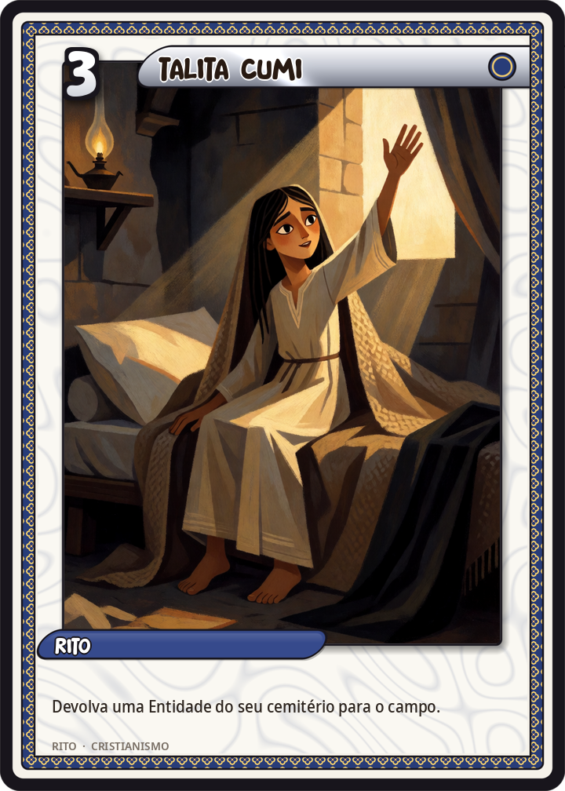</a>

<a href="cartas/cri_vale_dos_ossos_secos.md">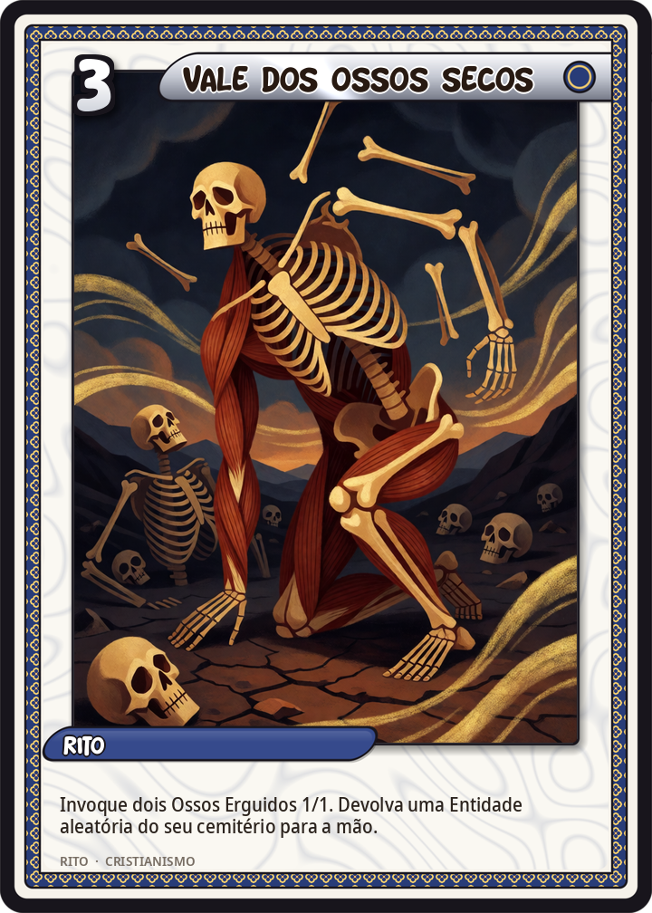</a> <a href="cartas/cri_granizo_e_fogo.md">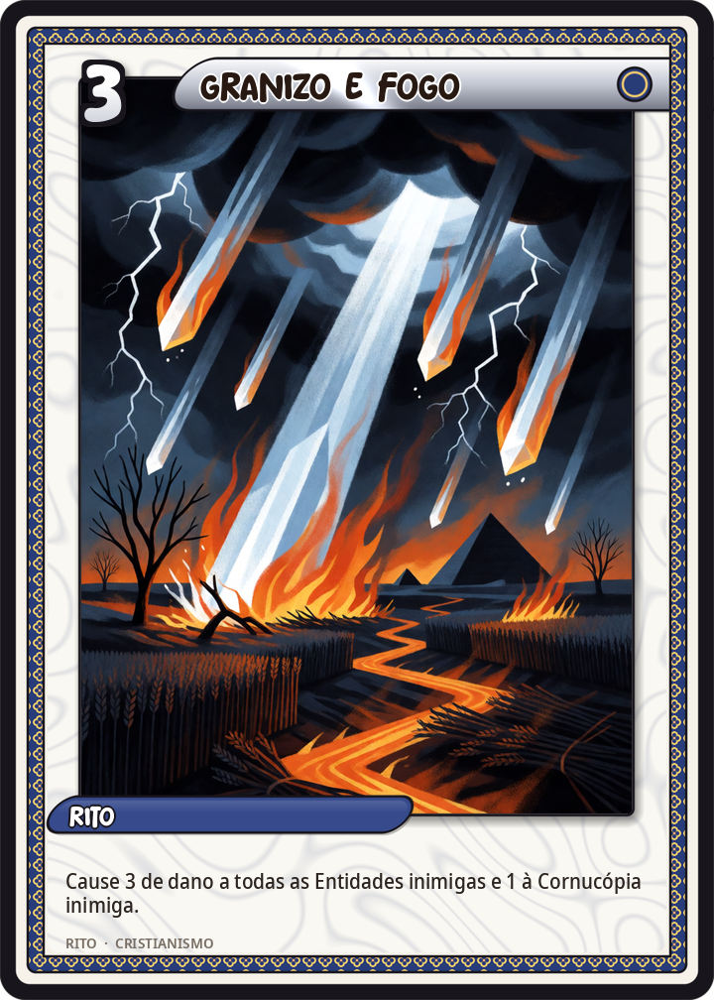</a> <a href="cartas/cri_juizo_final.md">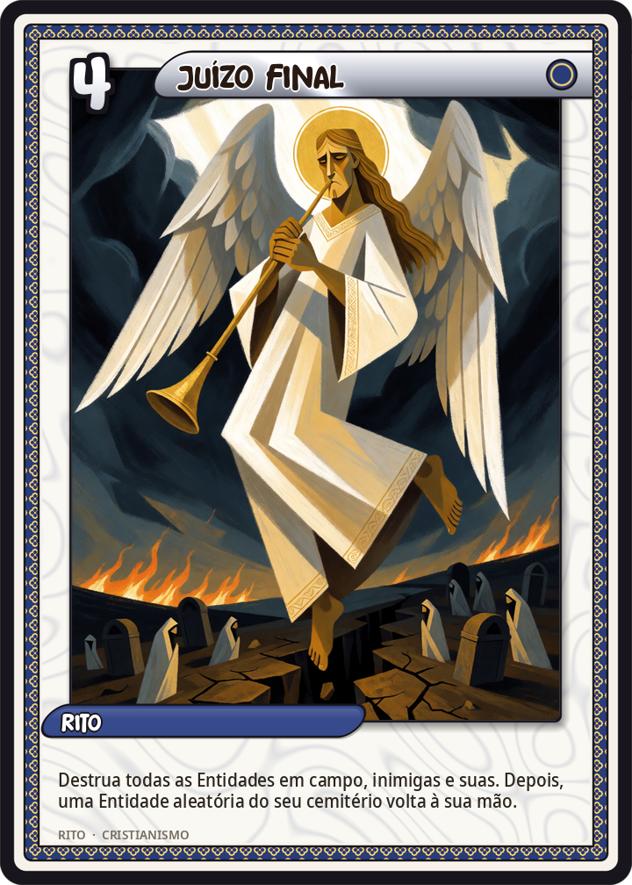</a>

| Carta | Atributos | Texto |
|---|---|---|
| [Multiplicação dos Pães](cartas/cri_multiplicacao_dos_paes.md) | Rito · custo 2 | Compre 2 cartas. Cure 2 da sua Cornucópia. |
| [Exorcismo](cartas/cri_exorcismo.md) | Rito · custo 2 | Devolva uma Entidade inimiga à mão do dono. Cure 4 de Vida de uma Entidade aliada. |
| [Praga dos Gafanhotos](cartas/cri_praga_dos_gafanhotos.md) | Rito · custo 2 | Causa 2 de dano a todas as Entidades inimigas. O oponente descarta 1 carta aleatória. |
| [Talita Cumi](cartas/cri_talita_cumi.md) ×2 | Rito · custo 3 | Reviva uma Entidade do seu cemitério para o campo. |
| [Vale dos Ossos Secos](cartas/cri_vale_dos_ossos_secos.md) | Rito · custo 3 | Invoque dois Ossos Erguidos 1/1. Reviva uma Entidade aleatória do seu cemitério para a mão. |
| [Granizo e Fogo](cartas/cri_granizo_e_fogo.md) | Rito · custo 3 | Causa 3 de dano a todas as Entidades inimigas e 1 de dano à Cornucópia inimiga. |
| [Juízo Final](cartas/cri_juizo_final.md) | Rito · custo 4 | Destrua todas as Entidades em campo, inimigas e suas. Depois, uma Entidade aleatória do seu cemitério volta à sua mão. |

## Relíquias

<a href="cartas/cri_funda_de_davi.md">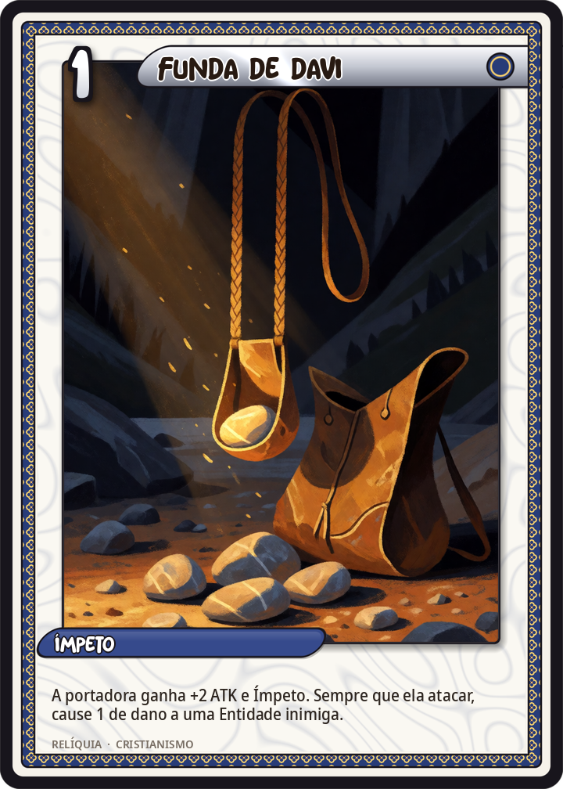</a> <a href="cartas/cri_veu_de_veronica.md">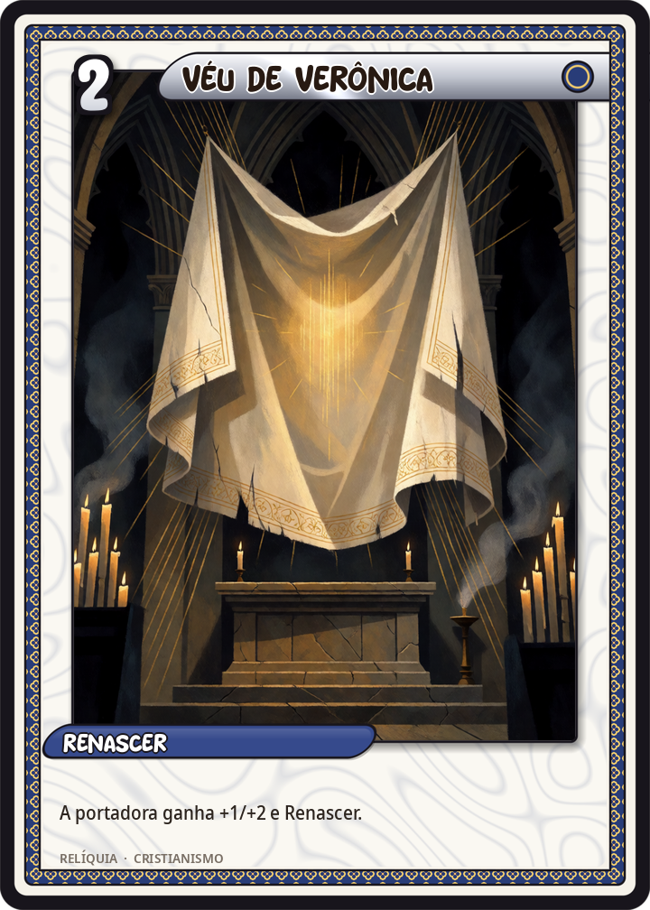</a> <a href="cartas/cri_santo_graal.md">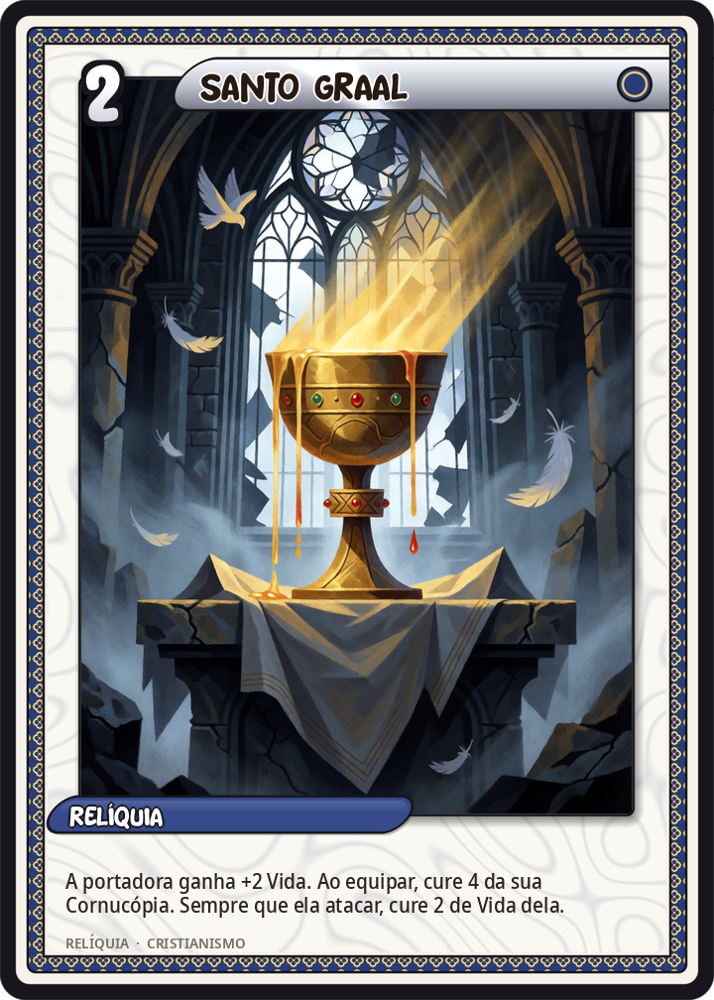</a> <a href="cartas/cri_arca_da_alianca.md">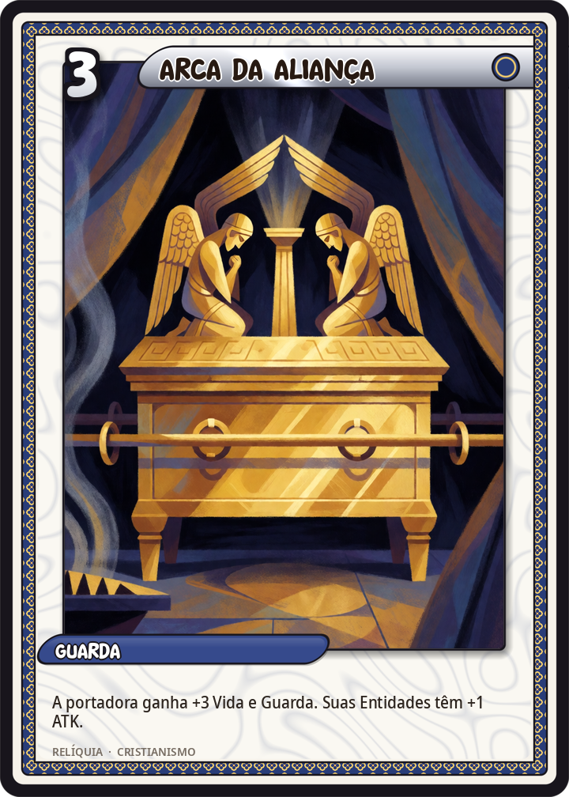</a>

| Carta | Atributos | Texto |
|---|---|---|
| [Funda de Davi](cartas/cri_funda_de_davi.md) | Relíquia · custo 1 | A portadora ganha +2 ATK e Ímpeto. Quando ela ataca, causa 1 de dano a uma Entidade inimiga à sua escolha. |
| [Véu de Verônica](cartas/cri_veu_de_veronica.md) | Relíquia · custo 2 | A portadora ganha +1/+2 e Renascer. |
| [Santo Graal](cartas/cri_santo_graal.md) | Relíquia · custo 2 | A portadora ganha +0/+2. Ao equipar, cure 4 da sua Cornucópia. Quando a portadora ataca, cure 2 dela. |
| [Arca da Aliança](cartas/cri_arca_da_alianca.md) | Relíquia · custo 3 | A portadora ganha +0/+3 e Guarda. Enquanto a Arca estiver em campo, suas Entidades têm +1 ATK. |
