# Indígena brasileira

[← Wiki KodeX](README.md)

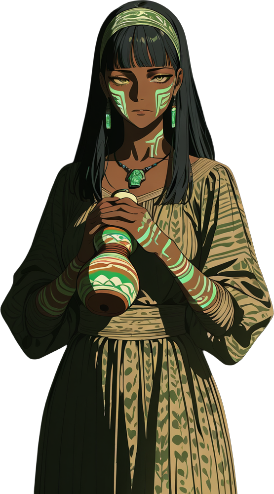

**Campeão no torneio:** Moema Arani — *Guardiã da Mata*

## Identidade do deck

O deck indígena **defende a mata e pune quem a invade**. Suas guardiãs têm **Guarda** (Curupira e Boitatá cedo; a Vitória-régia de Jaci e Tupã no fim; o Cocar dá Guarda a quem não tem) e várias devolvem dano a quem as ataca (Curupira, Boitatá, Mapinguari — só contra **ataques**: dano de Rito não tem atacante e não dispara o contragolpe; e a guardiã que ataca não se fere no próprio contragolpe). O campo cresce por **tokens de animais e espíritos** — Queixada do Caipora, Veado Branco do Anhangá, Aruanãs da dança Karajá, a Vitória-régia de Jaci, o Espírito do maracá — e é sustentado por **cura pela natureza**: Cauim, Dança do Aruanã, Dádiva de Mani, Mundéu, Terra sem Males e a aura noturna de Jaci. Os Selos são **armadilhas da mata** (Arapuca, Mundéu — disparam quando o inimigo ataca **uma Entidade sua**, não a Cornucópia; o deck precisa manter um corpo em campo para armá-las) e feitiços de encantados (Matinta, sopro do pajé). O fogo aparece pontualmente — Boitatá e o Rito "Fogo de Monan" — como a única remoção em área do deck.

O que o deck **não** faz: quase não destrói Entidades (nenhum `destroy`; a remoção é devolver à mão com a Iara ou queimar com Monan) e tem pouco dano direto (Matinta e Monan, 1 cada). Ganha jogando longo: trava o campo com Guarda, acumula tokens, cura a Cornucópia e fecha com Tupã (dano em área ao entrar) ou com Terra sem Males num campo cheio. Sofre contra decks de `silence`/`bounce` (que anulam Guarda e tokens) e contra dano direto à Cornucópia, que a Guarda não bloqueia.

**25 cartas distintas · 32 no deck**

## Entidades

<a href="cartas/ind_saci_perere.md">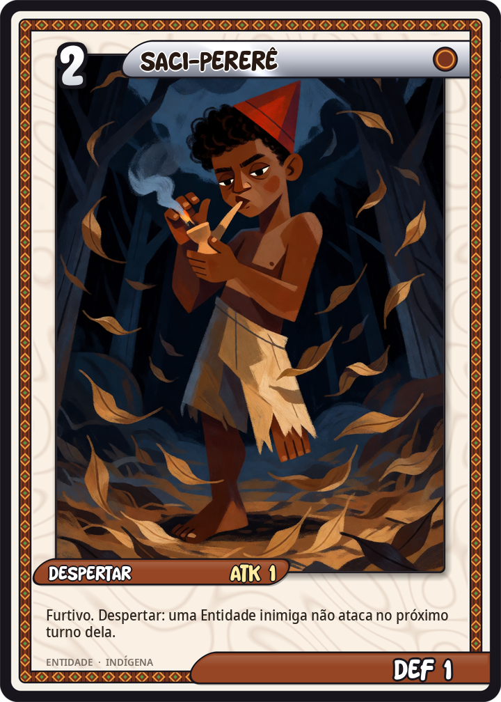</a> <a href="cartas/ind_curupira.md">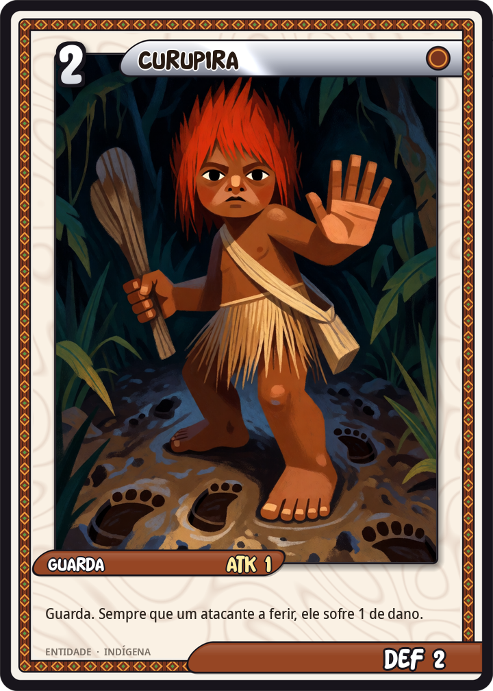</a> <a href="cartas/ind_caipora.md">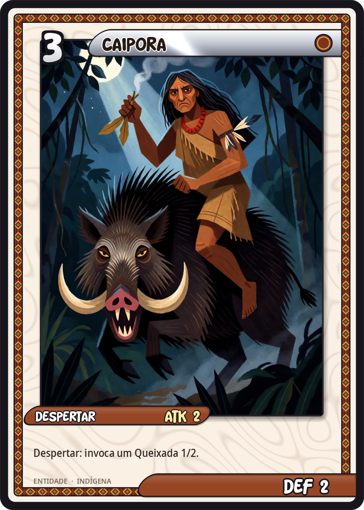</a> <a href="cartas/ind_iara.md">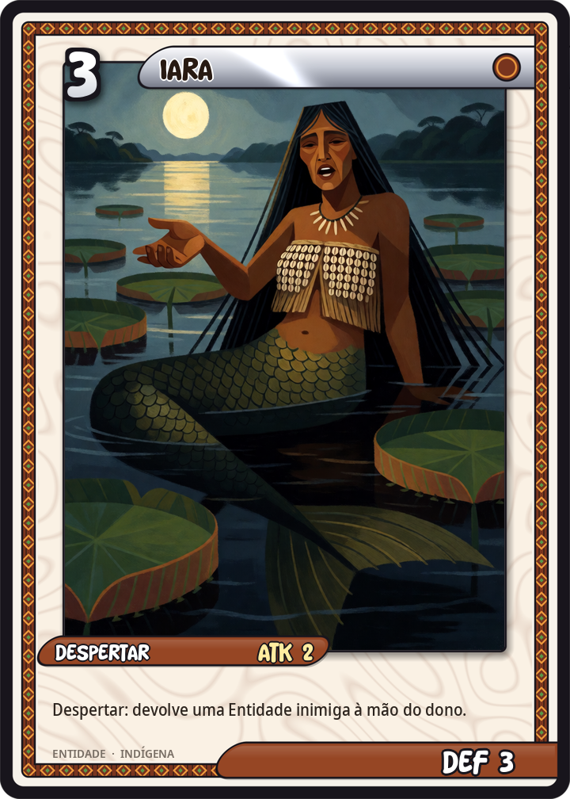</a>

<a href="cartas/ind_boitata.md">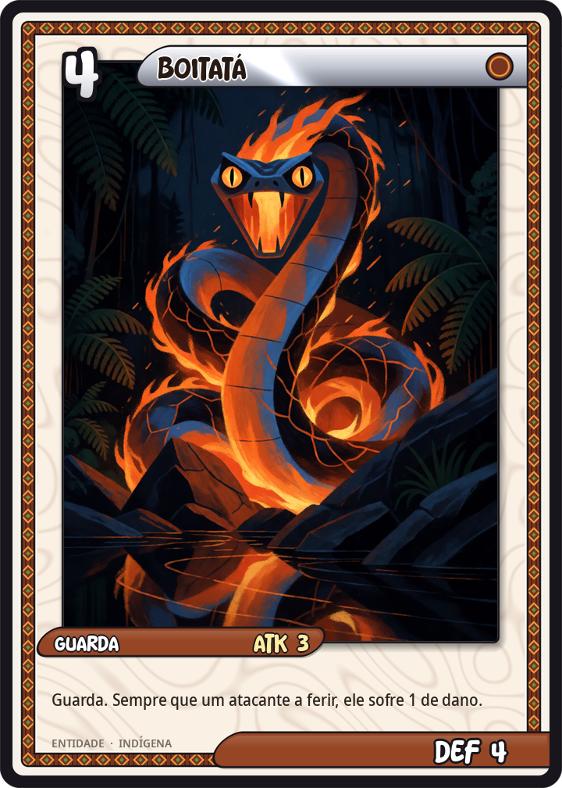</a> <a href="cartas/ind_anhanga.md">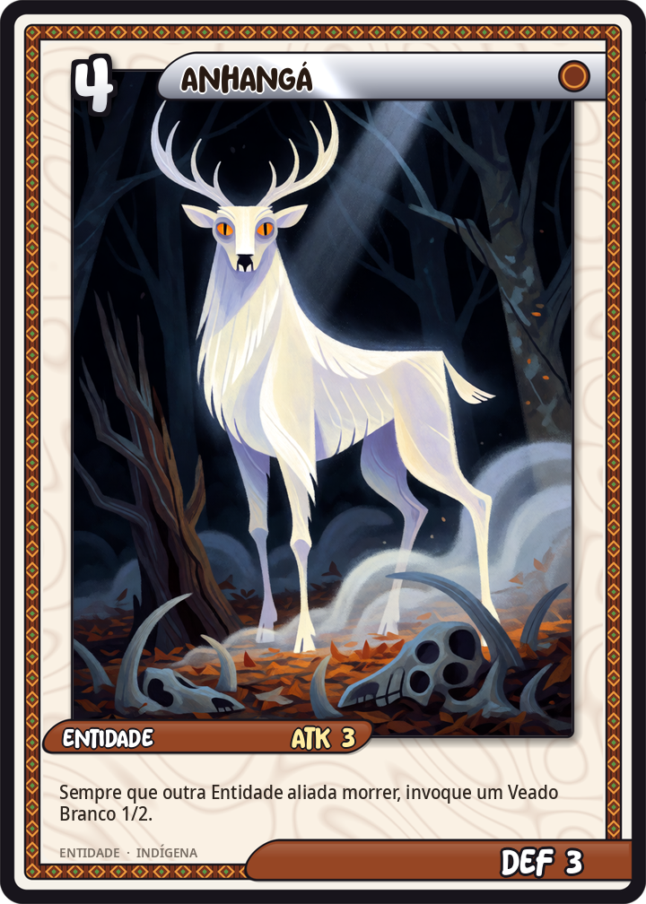</a> <a href="cartas/ind_mapinguari.md">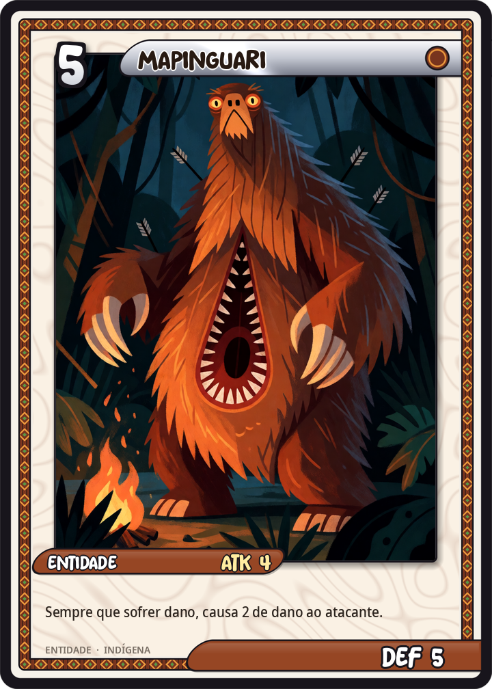</a> <a href="cartas/ind_cobra_grande.md">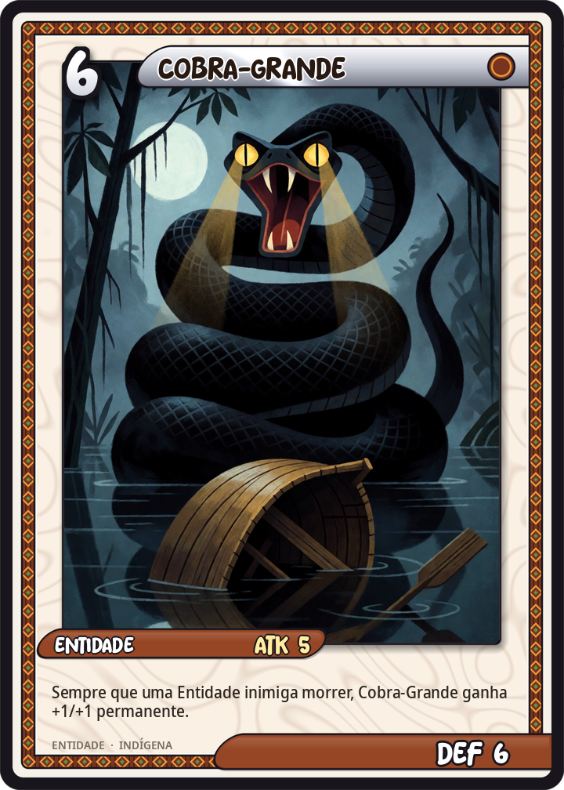</a>

<a href="cartas/ind_jaci.md">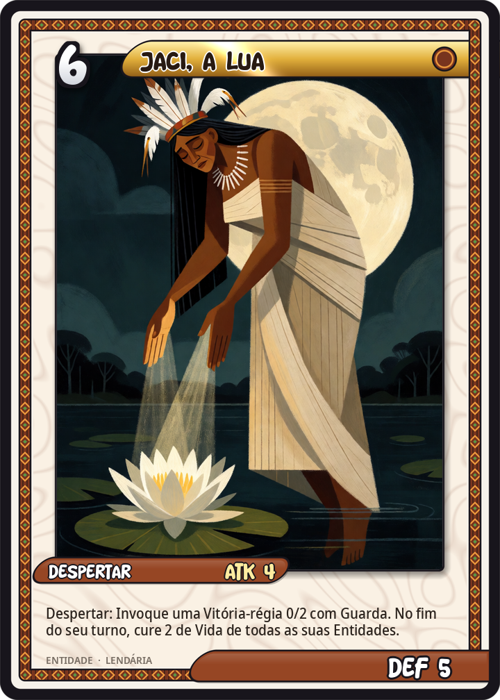</a> <a href="cartas/ind_tupa.md">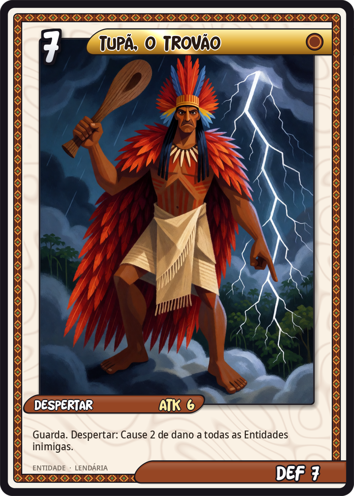</a>

| Carta | Atributos | Texto |
|---|---|---|
| [Saci-Pererê](cartas/ind_saci_perere.md) ×2 | Entidade · custo 2 · ATK 1 / DEF 1 | Furtivo. Despertar: uma Entidade inimiga não ataca no próximo turno dela. |
| [Curupira](cartas/ind_curupira.md) ×2 | Entidade · custo 2 · ATK 1 / DEF 2 | Guarda. Sempre que sofrer dano, causa 1 de dano ao atacante. |
| [Caipora](cartas/ind_caipora.md) ×2 | Entidade · custo 3 · ATK 2 / DEF 2 | Despertar: invoca um Queixada 1/2. |
| [Iara](cartas/ind_iara.md) | Entidade · custo 3 · ATK 2 / DEF 3 | Despertar: devolve uma Entidade inimiga à mão do dono. |
| [Boitatá](cartas/ind_boitata.md) ×2 | Entidade · custo 4 · ATK 3 / DEF 4 | Guarda. Sempre que sofrer dano de um ataque, causa 1 de dano ao atacante. |
| [Anhangá](cartas/ind_anhanga.md) | Entidade · custo 4 · ATK 3 / DEF 3 | Sempre que outra Entidade aliada morrer, invoca um Veado Branco 1/2. |
| [Mapinguari](cartas/ind_mapinguari.md) | Entidade · custo 5 · ATK 4 / DEF 5 | Sempre que sofrer dano, causa 2 de dano ao atacante. |
| [Cobra-Grande](cartas/ind_cobra_grande.md) | Entidade · custo 6 · ATK 5 / DEF 6 | Sempre que uma Entidade inimiga morrer, Cobra-Grande ganha +1/+1 permanente. |
| [Jaci, a Lua](cartas/ind_jaci.md) | Entidade · custo 6 · ATK 4 / DEF 5 · **Lendária** | Lendária. Despertar: invoca uma Vitória-régia 0/2 com Guarda. No fim do seu turno, cura 2 em todas as Entidades aliadas. |
| [Tupã, o Trovão](cartas/ind_tupa.md) | Entidade · custo 7 · ATK 6 / DEF 7 · **Lendária** | Lendária. Guarda. Despertar: causa 2 de dano a todas as Entidades inimigas. |

## Selos

<a href="cartas/ind_arapuca.md">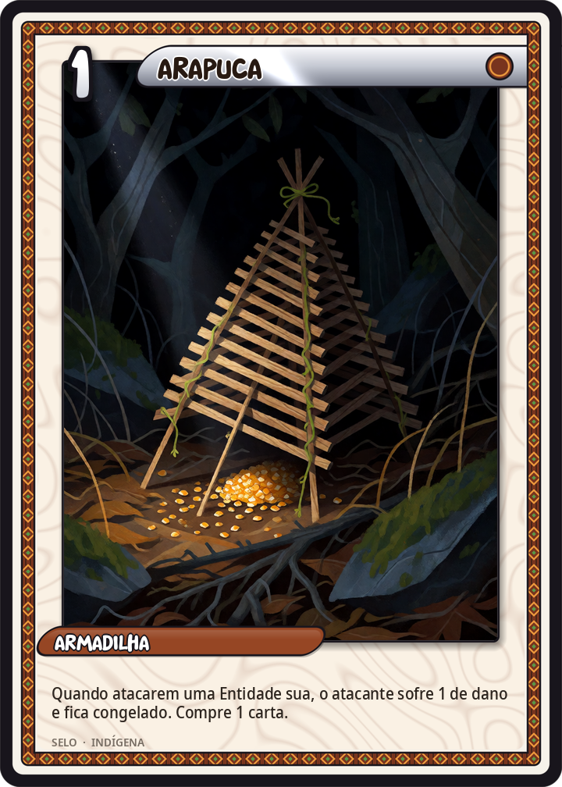</a> <a href="cartas/ind_mundeu.md">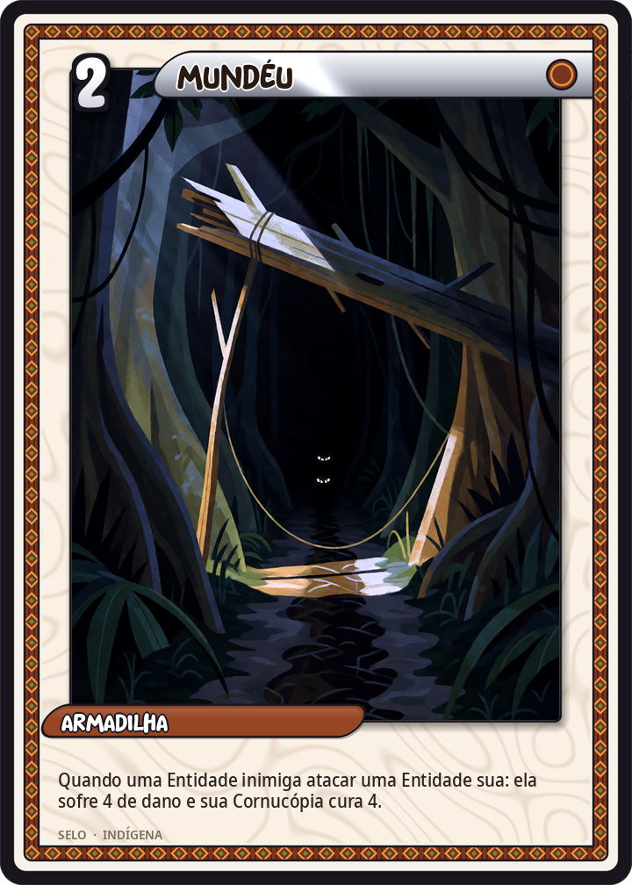</a> <a href="cartas/ind_assovio_da_matinta.md">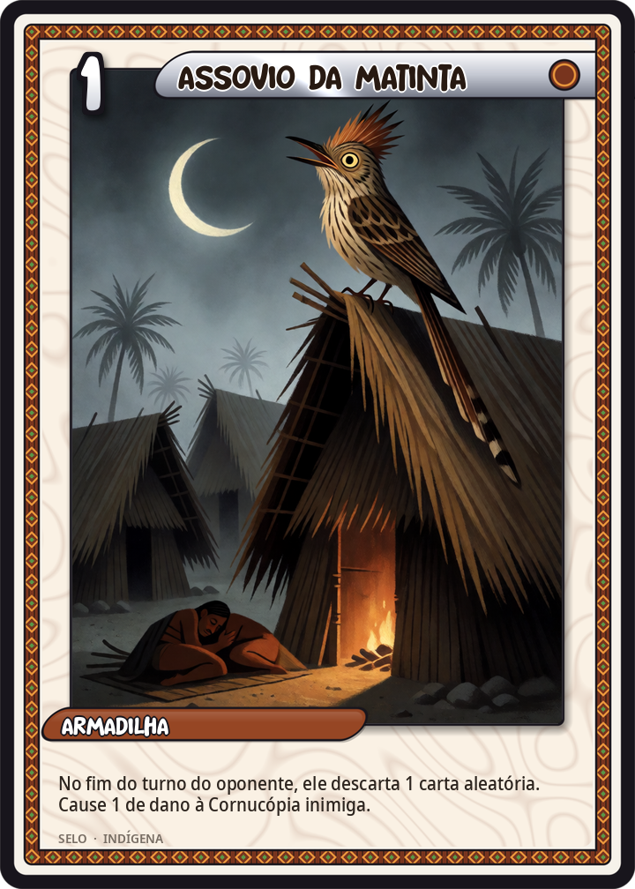</a> <a href="cartas/ind_sopro_do_paje.md">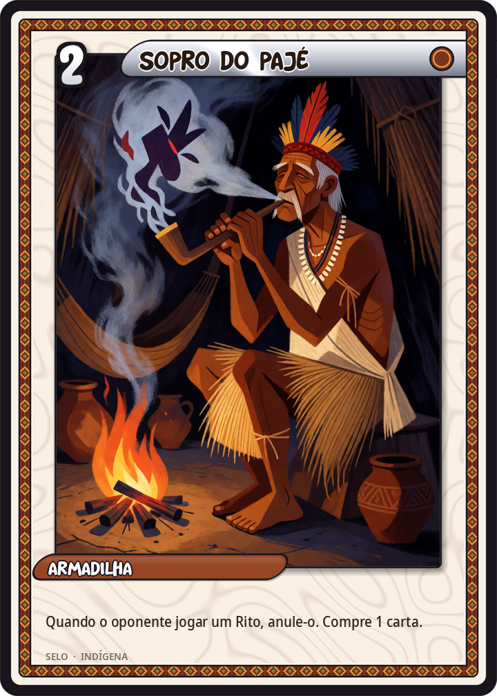</a>

| Carta | Atributos | Texto |
|---|---|---|
| [Arapuca](cartas/ind_arapuca.md) ×2 | Selo · custo 1 | Quando uma Entidade inimiga atacar uma Entidade sua: ela sofre 1 de dano, não ataca no próximo turno dela, e você compra 1 carta. |
| [Mundéu](cartas/ind_mundeu.md) ×2 | Selo · custo 2 | Quando uma Entidade inimiga atacar uma Entidade sua: ela sofre 4 de dano e sua Cornucópia cura 4. |
| [Assovio da Matinta](cartas/ind_assovio_da_matinta.md) | Selo · custo 1 | No fim do turno do oponente: ele descarta 1 carta aleatória e sua Cornucópia sofre 1 de dano. |
| [Sopro do Pajé](cartas/ind_sopro_do_paje.md) | Selo · custo 2 | Quando o oponente jogar um Rito: anula esse Rito e você compra 1 carta. |

## Ritos

<a href="cartas/ind_cauim.md">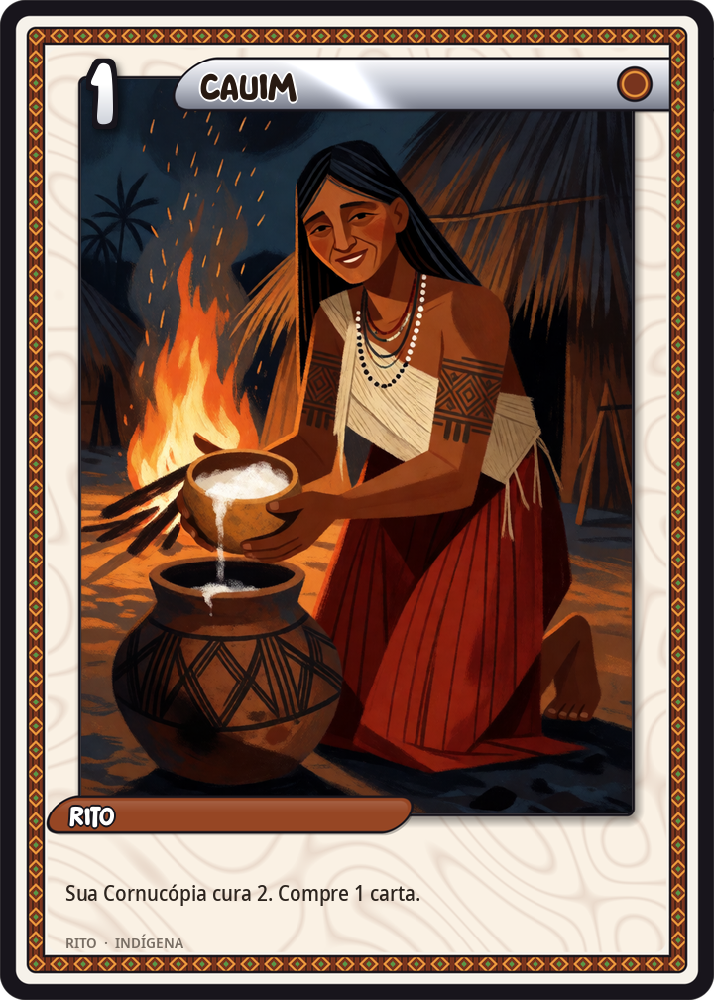</a> <a href="cartas/ind_visao_do_caapi.md">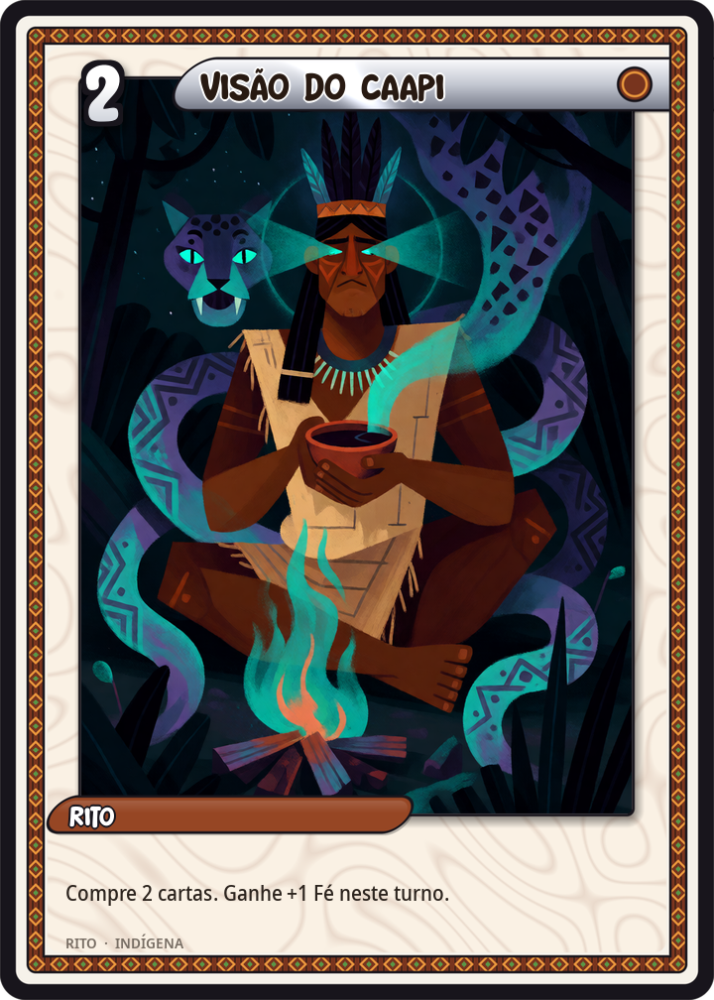</a> <a href="cartas/ind_fogo_de_monan.md">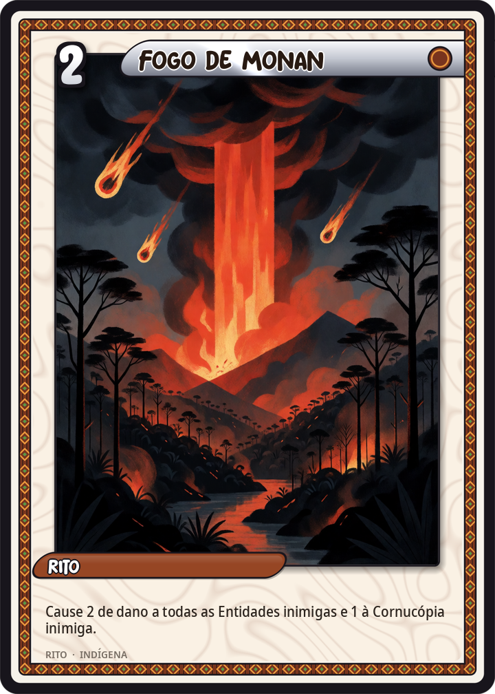</a> <a href="cartas/ind_danca_do_aruana.md">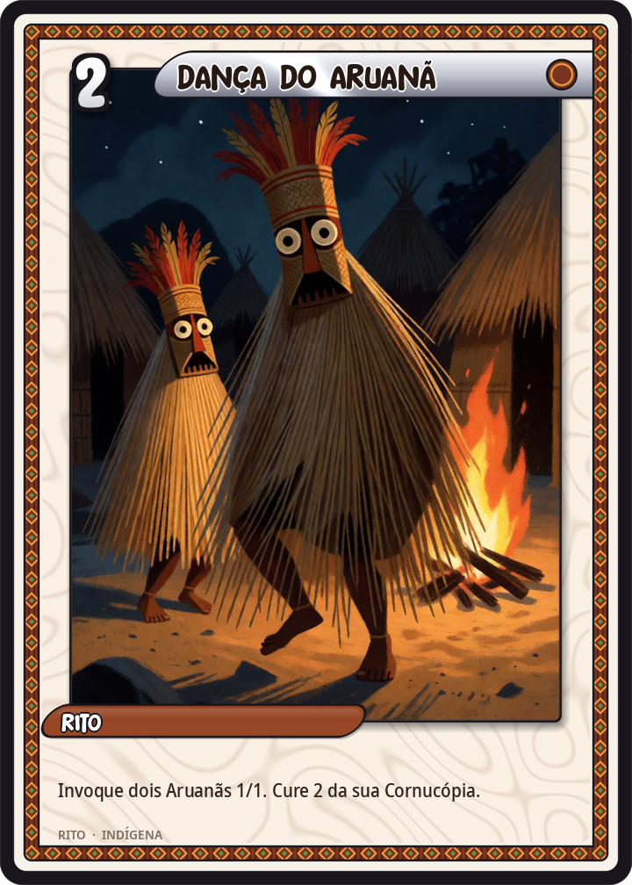</a>

<a href="cartas/ind_dadiva_de_mani.md">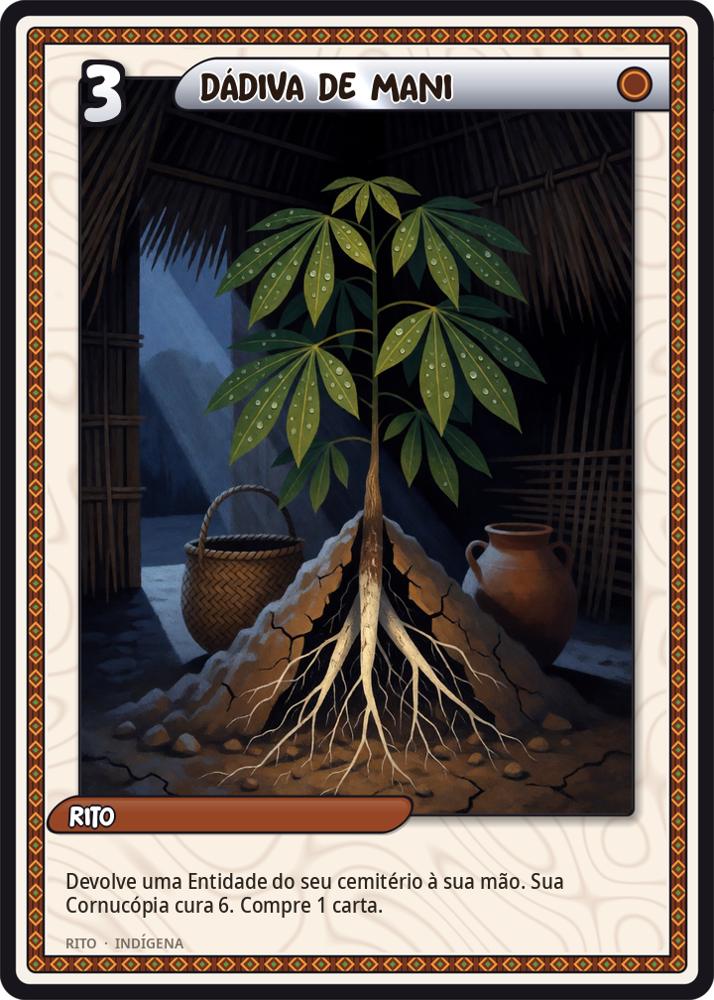</a> <a href="cartas/ind_kuarup.md">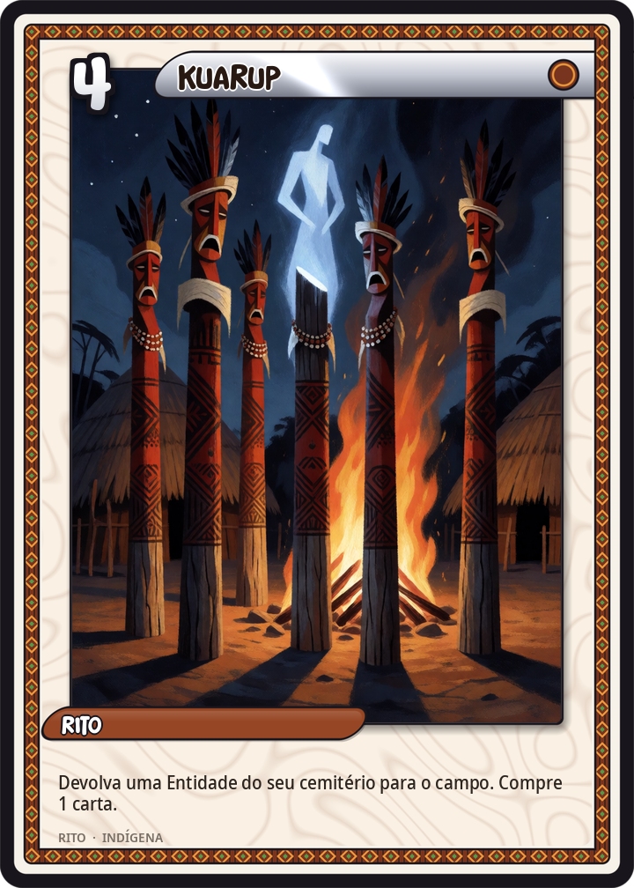</a> 

| Carta | Atributos | Texto |
|---|---|---|
| [Cauim](cartas/ind_cauim.md) ×2 | Rito · custo 1 | Sua Cornucópia cura 2. Compre 1 carta. |
| [Visão do Caapi](cartas/ind_visao_do_caapi.md) | Rito · custo 2 | Compre 2 cartas. Ganhe +1 Fé neste turno. |
| [Fogo de Monan](cartas/ind_fogo_de_monan.md) | Rito · custo 2 | Causa 2 de dano a todas as Entidades inimigas e 1 de dano à Cornucópia inimiga. |
| [Dança do Aruanã](cartas/ind_danca_do_aruana.md) | Rito · custo 2 | Invoca dois Aruanãs 1/1. Sua Cornucópia cura 2. |
| [Dádiva de Mani](cartas/ind_dadiva_de_mani.md) | Rito · custo 3 | Devolve uma Entidade do seu cemitério à sua mão. Sua Cornucópia cura 6. Compre 1 carta. |
| [Kuarup](cartas/ind_kuarup.md) | Rito · custo 4 | Traz uma Entidade do seu cemitério de volta ao campo. Compre 1 carta. |
| [Terra sem Males](cartas/ind_terra_sem_males.md) | Rito · custo 4 | Todas as suas Entidades ganham +1/+1 permanente. Sua Cornucópia cura 4. |

## Relíquias

<a href="cartas/ind_ibirapema.md">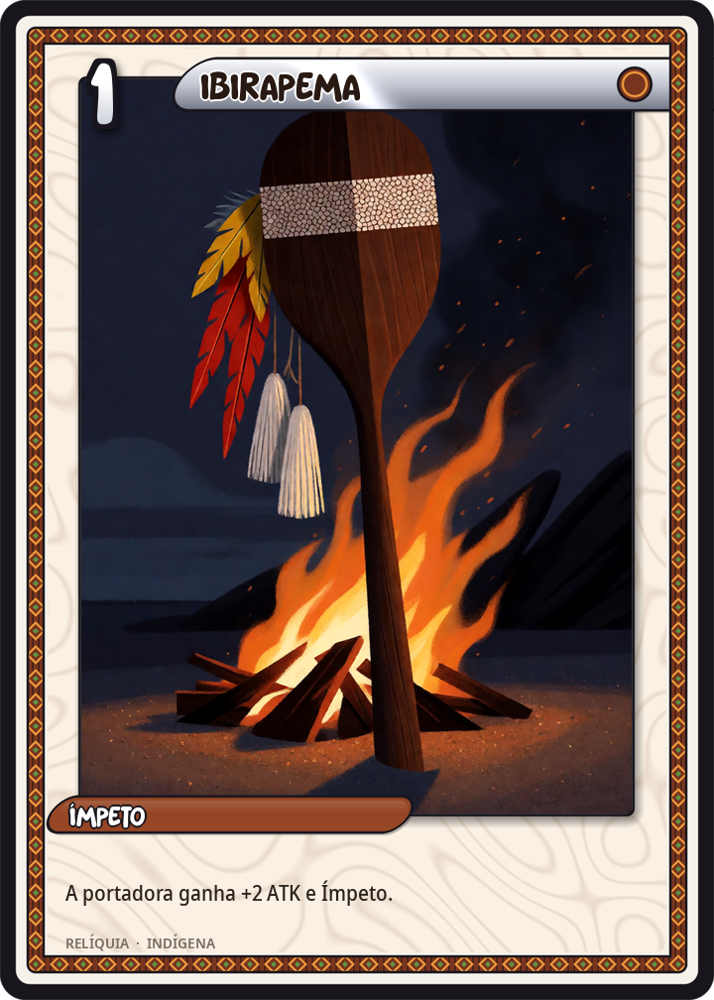</a> <a href="cartas/ind_muiraquita.md">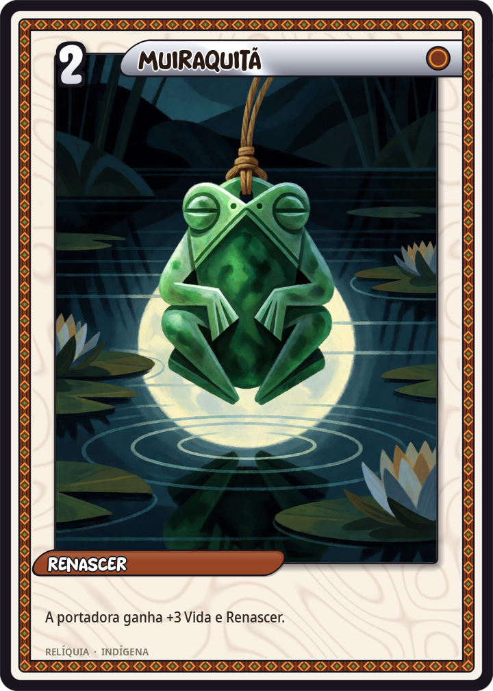</a> <a href="cartas/ind_maraca_do_paje.md">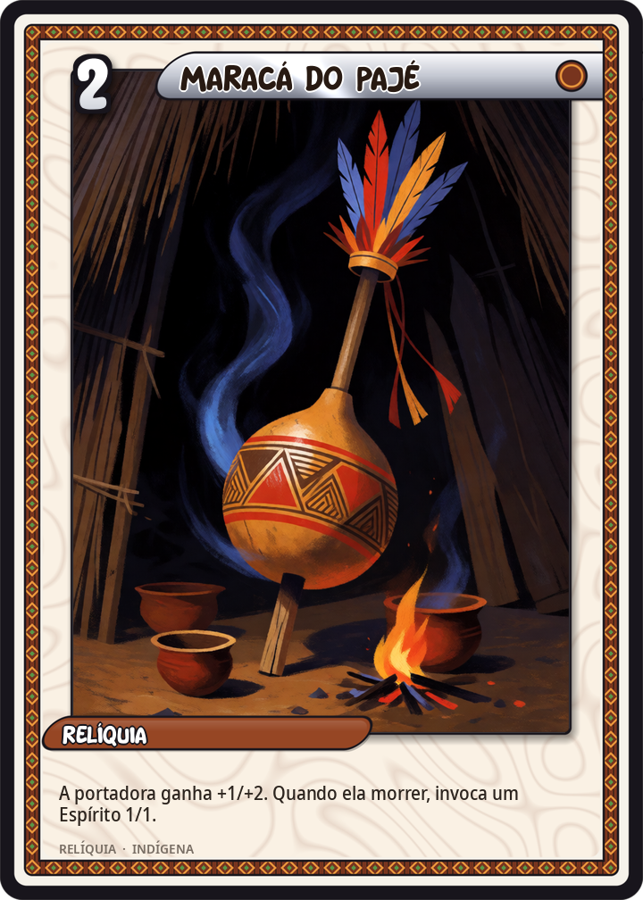</a> <a href="cartas/ind_cocar_do_morubixaba.md">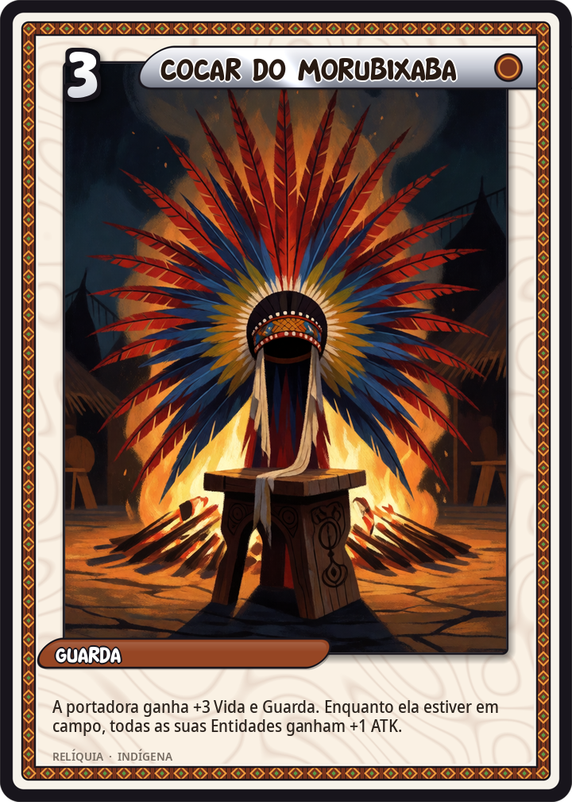</a>

| Carta | Atributos | Texto |
|---|---|---|
| [Ibirapema](cartas/ind_ibirapema.md) | Relíquia · custo 1 | A portadora ganha +2 ATK e Ímpeto. |
| [Muiraquitã](cartas/ind_muiraquita.md) | Relíquia · custo 2 | A portadora ganha +3 Vida e Renascer. |
| [Maracá do Pajé](cartas/ind_maraca_do_paje.md) | Relíquia · custo 2 | A portadora ganha +1/+2. Quando ela morrer, invoca um Espírito 1/1. |
| [Cocar do Morubixaba](cartas/ind_cocar_do_morubixaba.md) | Relíquia · custo 3 | A portadora ganha +3 Vida e Guarda. Enquanto ela estiver em campo, todas as suas Entidades ganham +1 ATK. |
