# Taoismo

[← Wiki KodeX](README.md)

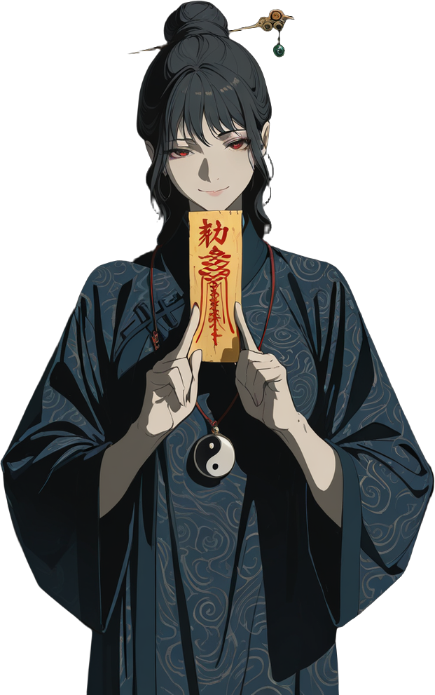

**Campeão no torneio:** Lin Yuehua — *A Imortal do Pico Nublado*

## Identidade do deck

**Equilíbrio e imortalidade.** O deck quase não causa dano direto (zero à Cornucópia inimiga): ele ganha prolongando a vida das próprias Entidades e encurtando a utilidade das inimigas. O yin-yang aparece como buff/debuff simétrico (Taiji dá +2/+2 a um lado e −2/−2 ao outro; o Dragão Azul cresce, o Tigre Branco pune); o **qi** é Fé temporária que circula (Circulação do Qi, Han Xiangzi); o **elixir** é Renascer e revive (Li Tieguai, Nezha, Pêssego da Imortalidade, Pílula de Ouro, Zhongli Quan, Xiwangmu, Pássaro Vermelho — o revive para o campo devolve corpos, não Despertares). Os **talismãs Fulu** são o Selo de controle (anular Rito) e os **Quatro Símbolos** são Selos-guardiões, um por direção, cada um com um gatilho diferente — escolha deliberada: guardiões passivos do altar, não seres que se invocam. O **espelho** desmascara (silêncio). A Lendária maior, o Imperador de Jade, não ataca a Cornucópia: ele é uma aura.

**Oito Imortais.** As oito figuras são Entidades baratas (custo 1–3), uma cópia cada, que valem mais em grupo: Lü Dongbin é aura de ATK, Lan Caihe e Han Xiangzi disparam com `ally_count_min`, He Xiangu cura todo turno, Cao Guojiu segura a linha com Guarda, Zhongli Quan e Li Tieguai trazem corpos de volta. O plano típico: turnos 1–3 enfileiram Imortais; turno 4 Taiji ou Nezha; turnos 5–7 Erlang, Guan Yu, Xiwangmu reciclando quem morreu; turno 7 o Imperador de Jade transforma uma mesa de 1/2 em uma mesa de 2/3. Fraquezas: dano em área (uma mesa de corpos pequenos morre junto), silêncio (as auras somem) e devolver à mão (Despertares gastos). Pontos fortes: atrito longo e recuperação.

**Três camadas de fonte.** O deck lê "taoismo" de forma ampla e cada carta diz de onde vem: filosofia (Daodejing, Zhuangzi, Yijing → Taiji, Circulação do Qi), religião organizada (Baopuzi, Mestres Celestiais, Quanzhen → Fulu, Pílula de Ouro, Espelho, os Imortais patriarcas) e mitologia popular absorvida pelo taoismo religioso (Fengshen Yanyi, Jornada ao Oeste, culto dos Oito Imortais → Nezha, Erlang, Guan Yu, Imperador de Jade, Banquete).

**26 cartas distintas · 32 no deck**

## Entidades

<a href="cartas/tao_lan_caihe.md">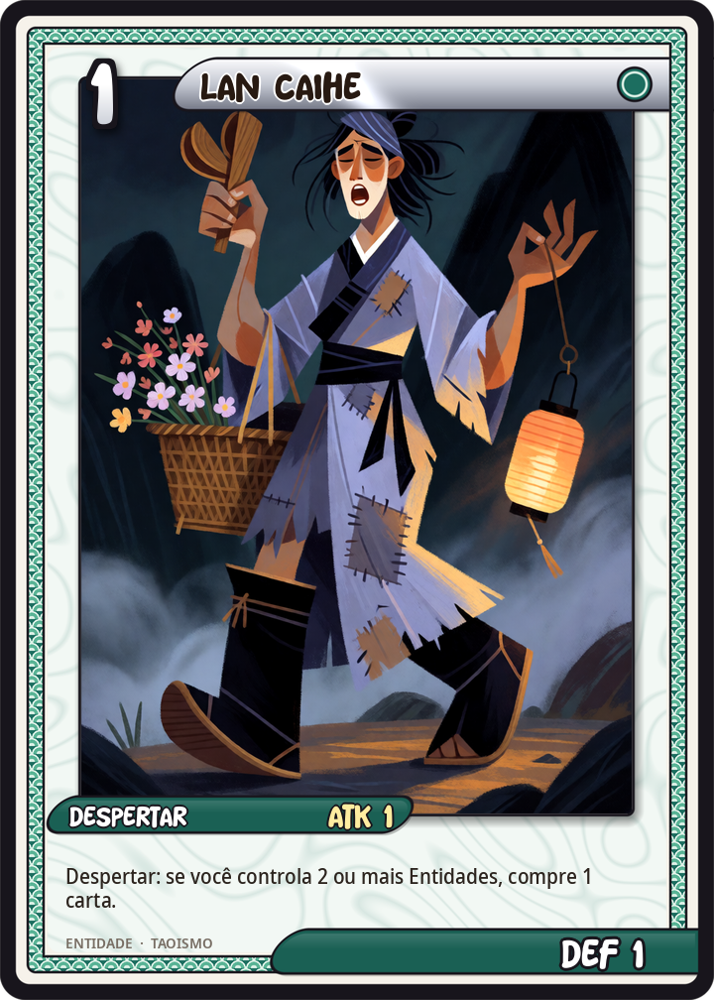</a> <a href="cartas/tao_he_xiangu.md">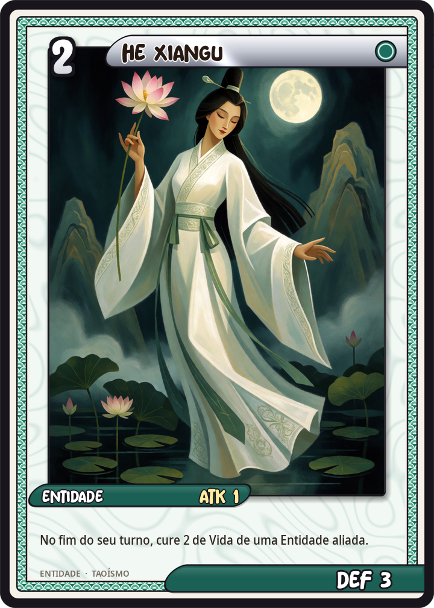</a>  <a href="cartas/tao_li_tieguai.md">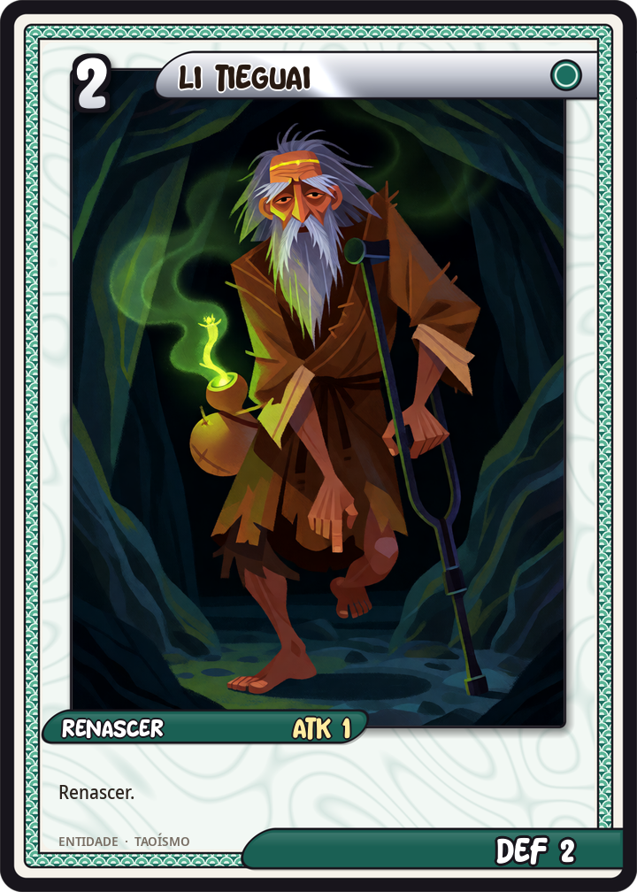</a>

 <a href="cartas/tao_lu_dongbin.md">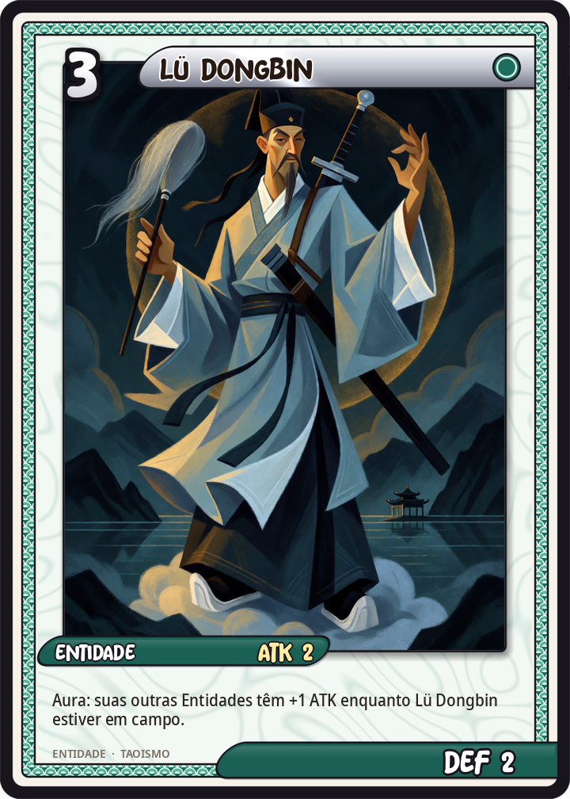</a> <a href="cartas/tao_zhang_guolao.md">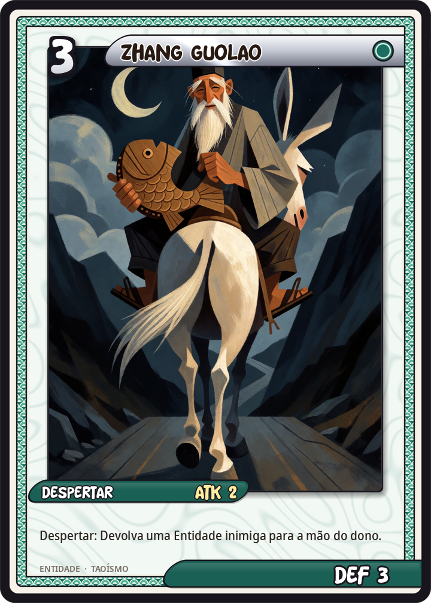</a> <a href="cartas/tao_cao_guojiu.md">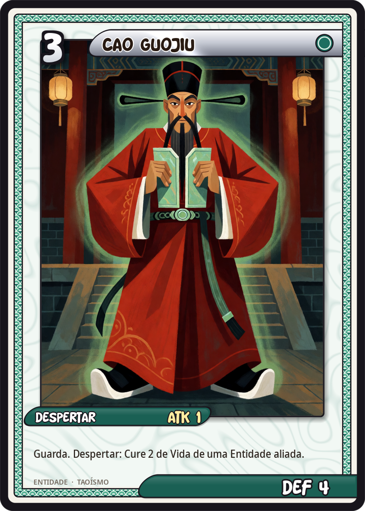</a>

<a href="cartas/tao_nezha.md">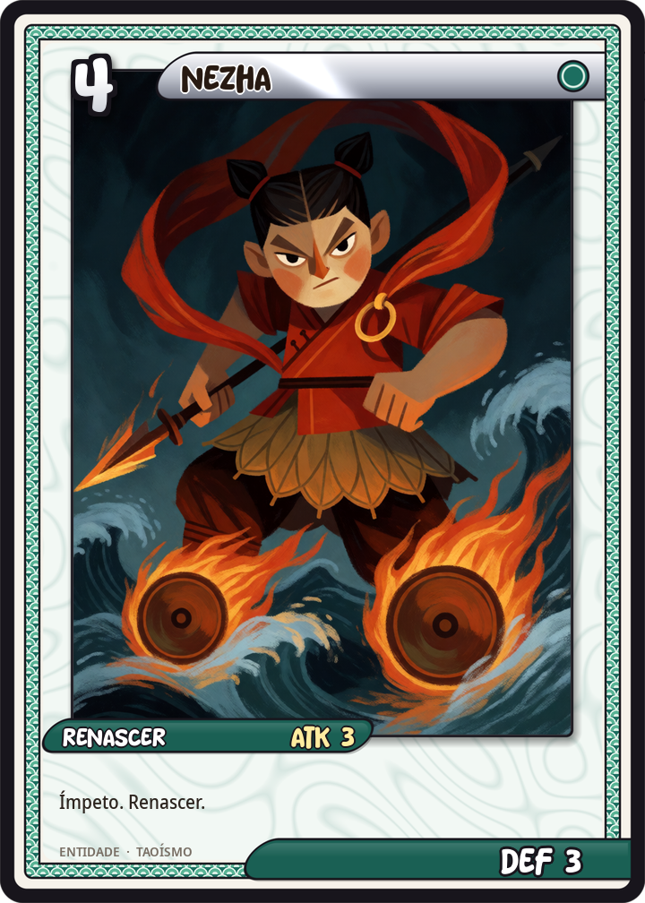</a> <a href="cartas/tao_zhong_kui.md">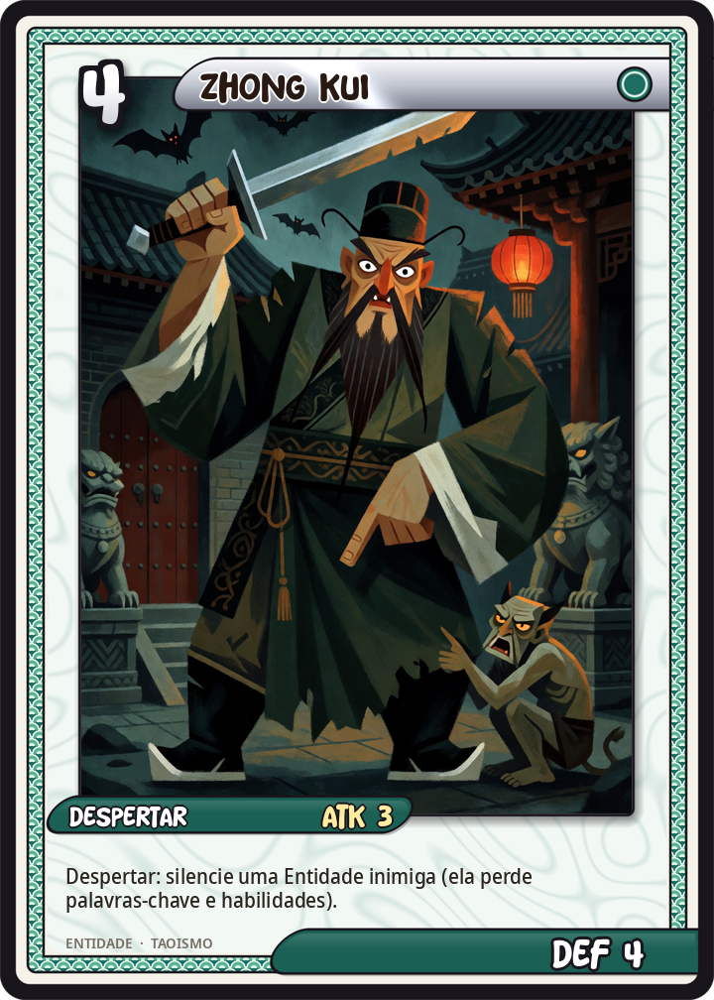</a> <a href="cartas/tao_erlang_shen.md">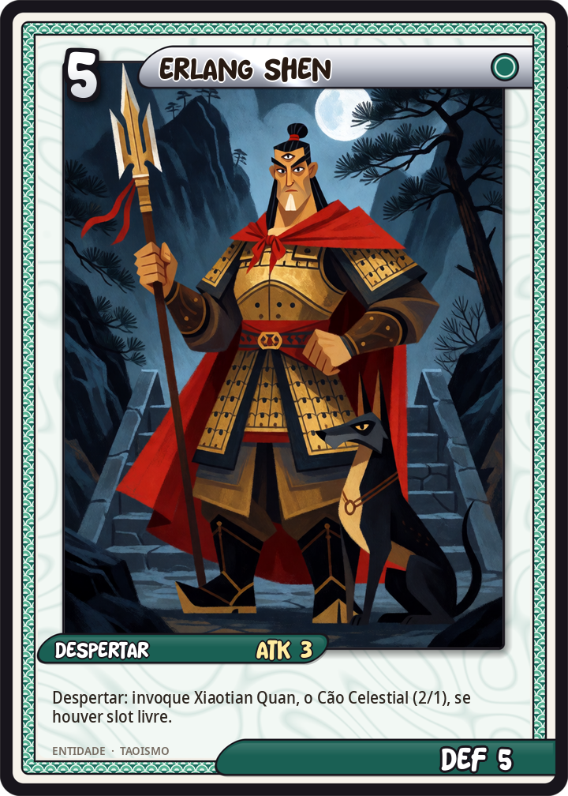</a> <a href="cartas/tao_guan_yu.md">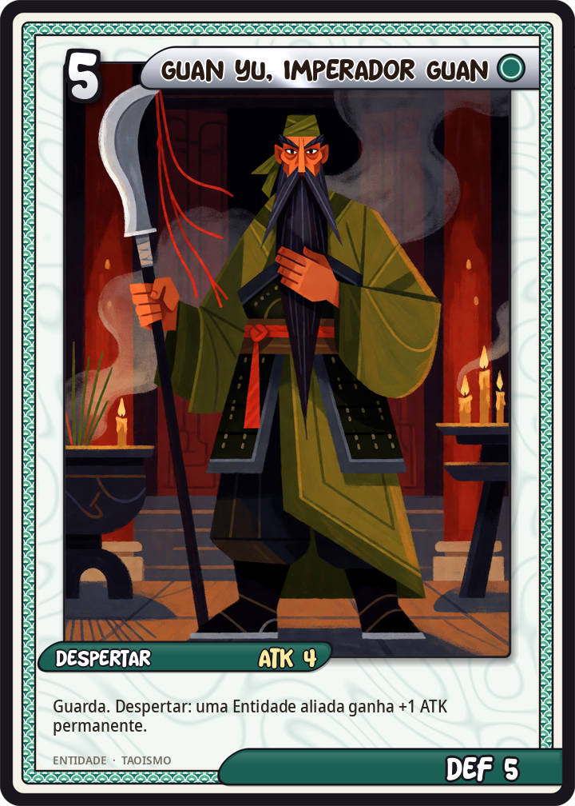</a>

<a href="cartas/tao_xiwangmu.md">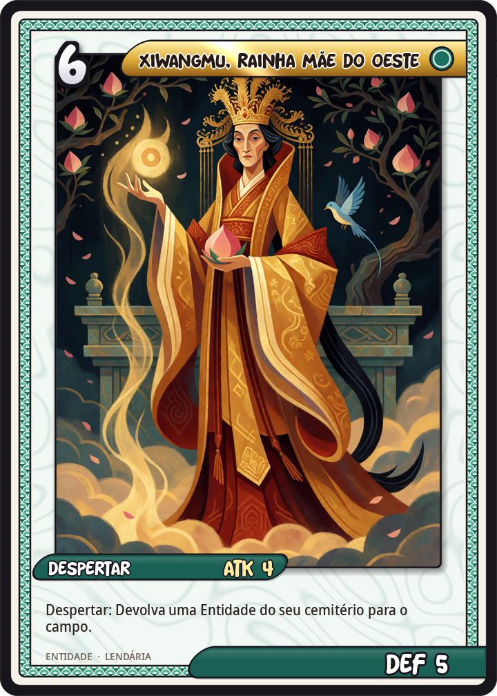</a> 

| Carta | Atributos | Texto |
|---|---|---|
| [Lan Caihe](cartas/tao_lan_caihe.md) | Entidade · custo 1 · ATK 1 / DEF 1 | Despertar: se você controla 2 ou mais Entidades, compre 1 carta. |
| [He Xiangu](cartas/tao_he_xiangu.md) | Entidade · custo 2 · ATK 1 / DEF 3 | No fim do seu turno, cure 2 de Vida de uma Entidade aliada. |
| [Han Xiangzi](cartas/tao_han_xiangzi.md) | Entidade · custo 2 · ATK 1 / DEF 2 | Despertar: se você controla 2 ou mais Entidades, ganhe 2 Fé temporária. |
| [Li Tieguai](cartas/tao_li_tieguai.md) | Entidade · custo 2 · ATK 1 / DEF 2 | Renascer. |
| [Zhongli Quan](cartas/tao_zhongli_quan.md) | Entidade · custo 3 · ATK 2 / DEF 3 | Despertar: devolva uma Entidade do seu cemitério para a sua mão. |
| [Lü Dongbin](cartas/tao_lu_dongbin.md) | Entidade · custo 3 · ATK 2 / DEF 2 | Aura: suas outras Entidades têm +1 ATK enquanto Lü Dongbin estiver em campo. |
| [Zhang Guolao](cartas/tao_zhang_guolao.md) | Entidade · custo 3 · ATK 2 / DEF 3 | Despertar: devolva uma Entidade inimiga à mão do dono. |
| [Cao Guojiu](cartas/tao_cao_guojiu.md) | Entidade · custo 3 · ATK 1 / DEF 4 | Guarda. Despertar: cure 2 de Vida de uma Entidade aliada. |
| [Nezha](cartas/tao_nezha.md) | Entidade · custo 4 · ATK 3 / DEF 3 | Ímpeto. Renascer. |
| [Zhong Kui](cartas/tao_zhong_kui.md) | Entidade · custo 4 · ATK 3 / DEF 4 | Despertar: silencie uma Entidade inimiga (ela perde palavras-chave e habilidades). |
| [Erlang Shen](cartas/tao_erlang_shen.md) | Entidade · custo 5 · ATK 3 / DEF 5 | Despertar: invoque Xiaotian Quan, o Cão Celestial (2/1), se houver slot livre. |
| [Guan Yu, Imperador Guan](cartas/tao_guan_yu.md) | Entidade · custo 5 · ATK 4 / DEF 5 | Guarda. Despertar: uma Entidade aliada ganha +1 ATK permanente. |
| [Xiwangmu, Rainha Mãe do Oeste](cartas/tao_xiwangmu.md) | Entidade · custo 6 · ATK 4 / DEF 5 · **Lendária** | Despertar: reviva uma Entidade do seu cemitério para o campo. |
| [Imperador de Jade](cartas/tao_imperador_de_jade.md) | Entidade · custo 7 · ATK 5 / DEF 6 · **Lendária** | Aura: suas outras Entidades têm +1/+1 enquanto o Imperador de Jade estiver em campo. |

## Selos

<a href="cartas/tao_fulu_de_selamento.md">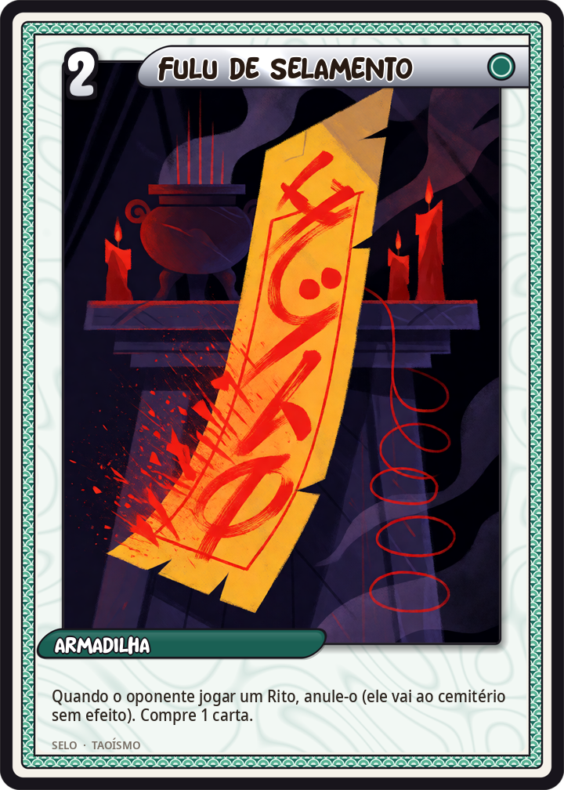</a> <a href="cartas/tao_dragao_azul_do_leste.md">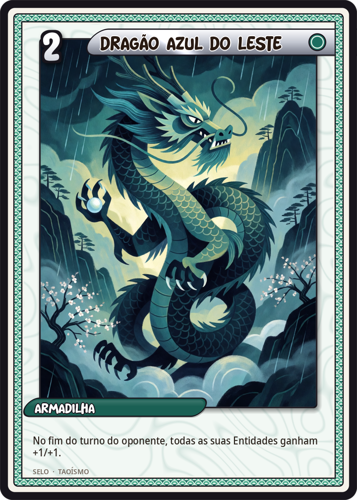</a> <a href="cartas/tao_tigre_branco_do_oeste.md">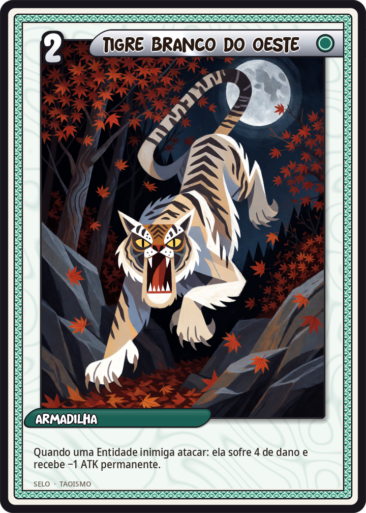</a> <a href="cartas/tao_passaro_vermelho_do_sul.md">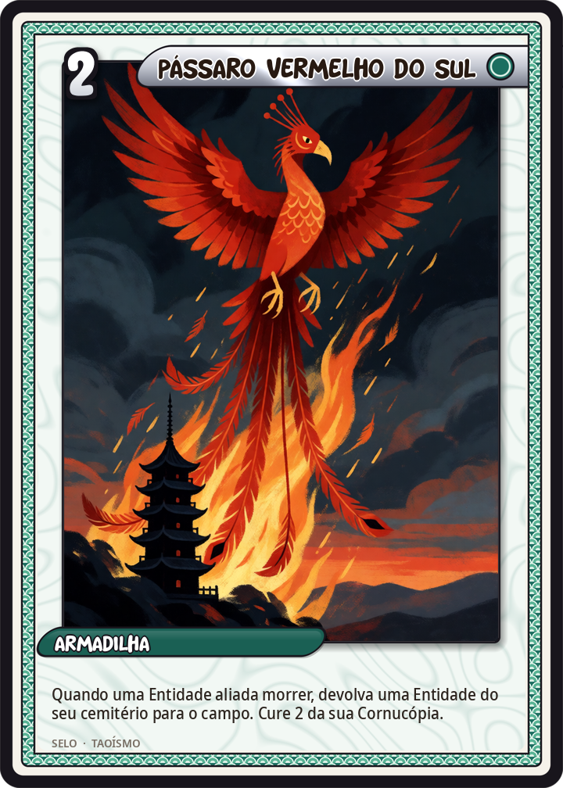</a>

<a href="cartas/tao_tartaruga_negra_do_norte.md">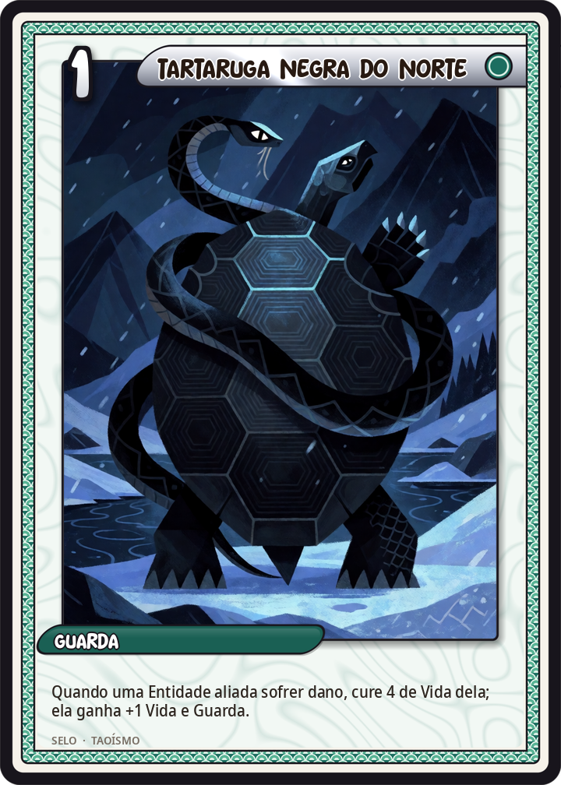</a>

| Carta | Atributos | Texto |
|---|---|---|
| [Fulu de Selamento](cartas/tao_fulu_de_selamento.md) ×2 | Selo · custo 2 | Quando o oponente jogar um Rito: anule-o (vai ao cemitério sem efeito). Compre 1 carta. |
| [Dragão Azul do Leste](cartas/tao_dragao_azul_do_leste.md) | Selo · custo 2 | No fim do turno do oponente: todas as suas Entidades ganham +1/+1 permanente. |
| [Tigre Branco do Oeste](cartas/tao_tigre_branco_do_oeste.md) | Selo · custo 2 | Quando uma Entidade inimiga atacar: ela sofre 4 de dano e recebe −1 ATK permanente. |
| [Pássaro Vermelho do Sul](cartas/tao_passaro_vermelho_do_sul.md) | Selo · custo 2 | Quando uma Entidade aliada morrer: reviva uma Entidade do seu cemitério para o campo e cure 2 da sua Cornucópia. |
| [Tartaruga Negra do Norte](cartas/tao_tartaruga_negra_do_norte.md) | Selo · custo 1 | Quando uma Entidade aliada sofrer dano: cure 4 de Vida dela; ela ganha +0/+1 permanente e Guarda. |

## Ritos

<a href="cartas/tao_circulacao_do_qi.md">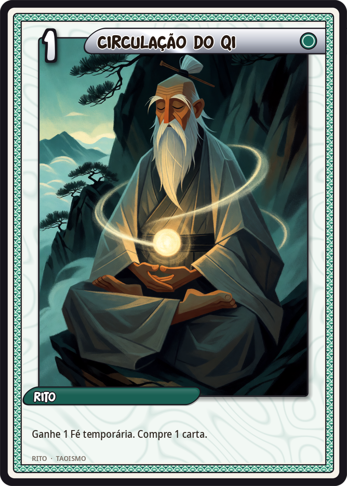</a> <a href="cartas/tao_flechas_de_houyi.md">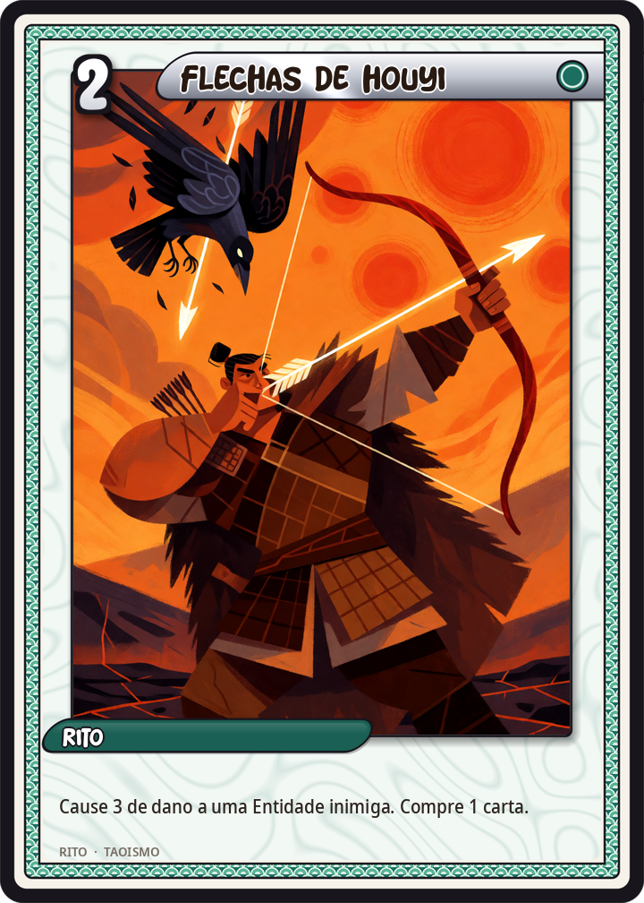</a> <a href="cartas/tao_pilula_de_ouro.md">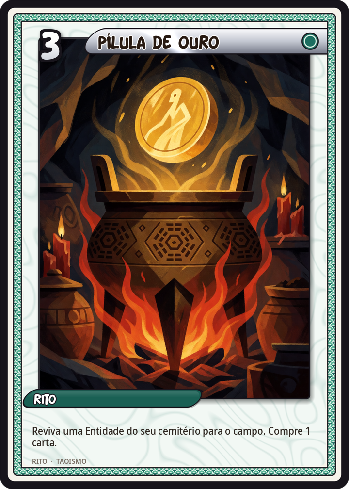</a> 

<a href="cartas/tao_taiji.md">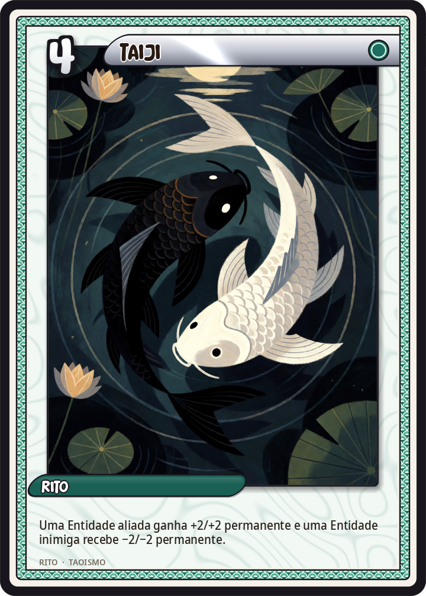</a>

| Carta | Atributos | Texto |
|---|---|---|
| [Circulação do Qi](cartas/tao_circulacao_do_qi.md) ×2 | Rito · custo 1 | Ganhe 1 Fé temporária. Compre 1 carta. |
| [Flechas de Houyi](cartas/tao_flechas_de_houyi.md) | Rito · custo 2 | Cause 3 de dano a uma Entidade inimiga. Compre 1 carta. |
| [Pílula de Ouro](cartas/tao_pilula_de_ouro.md) ×2 | Rito · custo 3 | Reviva uma Entidade do seu cemitério para o campo. Compre 1 carta. |
| [Banquete dos Pêssegos](cartas/tao_banquete_dos_pessegos.md) | Rito · custo 3 | Todas as suas Entidades ganham +1/+1 permanente. Cure 2 da sua Cornucópia. |
| [Taiji](cartas/tao_taiji.md) ×2 | Rito · custo 4 | Uma Entidade aliada ganha +2/+2 permanente e uma Entidade inimiga recebe −2/−2 permanente. |

## Relíquias

<a href="cartas/tao_pessego_da_imortalidade.md">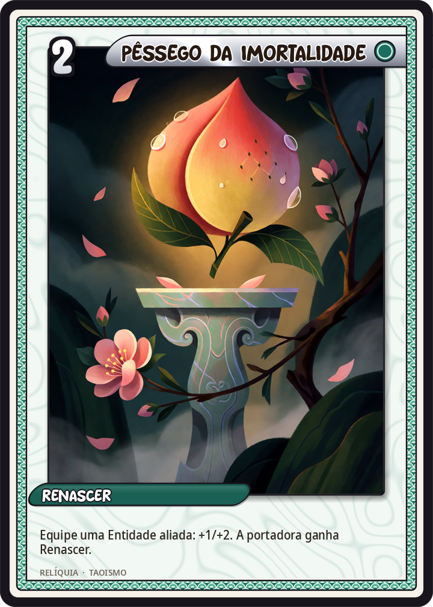</a> <a href="cartas/tao_espelho_de_bronze.md">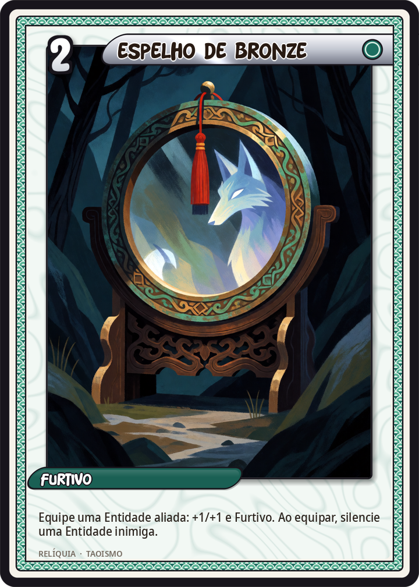</a>

| Carta | Atributos | Texto |
|---|---|---|
| [Pêssego da Imortalidade](cartas/tao_pessego_da_imortalidade.md) ×2 | Relíquia · custo 2 | Equipe uma Entidade aliada: +1/+2. A portadora ganha Renascer. |
| [Espelho de Bronze](cartas/tao_espelho_de_bronze.md) ×2 | Relíquia · custo 2 | Equipe uma Entidade aliada: +1/+1 e Furtivo. Ao equipar, silencie uma Entidade inimiga. |
